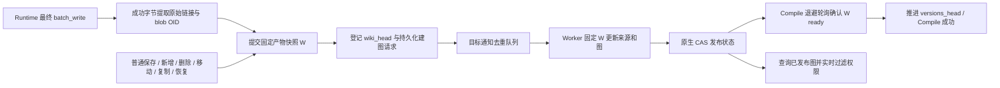

# Compile 产物关系图：实现与验收

实现分支：`feature/artifact-relation-graph-v2`。本记录说明最终实现；第 01–03 块文档保留阶段历史。

## 最终业务行为



- 全量和增量 Compile 共用 Worker；无变化 Compile 也确认指定快照已有图。
- Compile 期间普通写入被服务端拒绝。Runtime 使用按 operation 生成的随机写令牌，同时校验用户、目标范围和快照是否已提交；公开 `edit_source=compile` 不能取得授权。
- 普通写入在内容锁交接前提交快照和登记通知，随后释放目标 admission，避免等待语义任务时阻塞新的写入。
- 未处于 Compile 目标中的普通写入不增加图快照。普通 Skill 新包在 Semantic 接管前登记；有整体更新 lease 的 Skill 更新在成功或回滚后统一提交，避免把失败更新作为最终产物版本。
- 单文件、普通批次、目录新增、删除、复制、移动、版本恢复及 Skill 包入口已接入。嵌套目标更新包含所有相关祖先；移动目标在新 URI 创建独立版本和图。
- `wiki_head` 是实时产物快照，`versions_head` 是最近成功 Compile 快照；`version_index_head` 保留原有文件版本索引同步用途。
- `GET /api/v1/compile/artifact-relations?to=...` 返回 `result.nodes=[{uri}]`、`edges`、UTC `generated_at`。构建期间读取上一版图，最终失败报错，未注册或已删除目标报不存在。权限每次查询检查，边必须两端可见。

## 快照、来源与增量

Rust 内部提供 `git_snapshot_entries` 和 `git_snapshot_blobs`，一次遍历目标快照子树取得目录、文件和 OID，再按需批量读取变化 Markdown。快照保留空目录；内部文件及语义 sidecar 遵循现有快照过滤规则。

Compile 批次使用实际保存的最终字节提取链接，正常路径 Worker 按 OID 校验后直接复用。普通编辑通过快照 diff 更新来源；删除移除来源，移动按删除与新增处理。不可信或损坏的来源基线回退全量读取。

不变源页面的原始链接保留在来源中，因此新建断链目标可以恢复边，删除目标可以移除入边。增量保留未受影响的引用边，只更新变化源页和增删目标涉及的边。仍需遍历结构和原始链接检查影响范围，并整体序列化图；实现不声称整个构建成本仅与变化文件数成正比。

## 发布及故障恢复

存储仍只有三类业务 JSON，没有单独的发布指针文件：

```text
target_folders/{sha256(to)}/
  state.json                         # Compile 目标注册及 generation
  artifact_graph/{generation}/
    relation_sources.json            # Compile 批次临时来源
    artifact_relations_state.json    # 状态、revision、published_build_id
    builds/{build_id}/
      relation_sources.json          # 不可变来源与图共享 build_id
      artifact_relations.json
```

原先仅靠三个固定路径顺序替换不能防止锁过期后的迟到请求。因此最终采用不可变构建目录和状态 CAS：正常流程由 PathLock 协调，发布点是状态文件原生条件提交。每次转换带随机 revision，阻止重复状态的 ABA；构建目录不相互覆盖，目标 generation 隔离删除重建。

S3 条件提交使用 `If-Match`，首次创建使用 `If-None-Match: *`；明文比较和加密封装都经过同一接口。加密先读取真实密文、比较解密后的正文，再以原密文作为存储层条件，避免随机 nonce 导致错误比较。

状态进入 publishing 后写完整来源和图，再 CAS 为 ready。若最后一步响应丢失，确认精确候选；若完整候选图存在但 ready 未写，查询或恢复路径可 CAS 完成发布。新请求已经推进状态时，旧请求不能切回旧图。

发布后只清理已知的上一构建 ID，重试失败只清理该次候选 ID，不扫描并删除其他正在构建的目录。清理失败不改变发布结果；异常退出或已经发出的迟到写入可能留下不可见的孤立对象，需要后续存储清理，不会成为增量基线。

队列消息只有 `schema_version/account_id/to`。内存、SQLite、Redis 均仅合并 pending 消息；active 期间的新通知保持 follow-up。SQLite 事务与 Redis Lua 恢复去除已经有 pending 替代的旧投递。跨实例执行锁、最多三次构建尝试和定期恢复扫描处理故障和登记后入队中断。

## 验收依据

最终核心集中回归 **143 passed**；真实 S3 两种队列组合各 **4 passed**；启用 cache 的 Rust QueueFS **43 passed**；Runtime 身份转发 **55 passed**，SDK 客户端专项 **14 passed**；Skill 包和更新取消/锁回归组合 **18 passed**。这些测试组存在覆盖重叠，不合并计数。静态规则及 `git diff --check` 通过。

- 本地原生明文/加密：独立客户端并发来源合并、重复发布、released lease 拒绝及 stale CAS。
- 故障注入：在来源、图、状态写入前后失败；ready 写入丢失恢复；图或 ready 请求通过 lease 校验后暂停、使旧 lease 失效并发布新图，迟到请求不能改回旧图。
- 固定快照与增量：删除目标、恢复断链、移动源页、空目录、变化后还原；增量与全量的节点和边集合一致。
- 服务与 HTTP：Compile 成功后图已发布，Runtime 令牌校验，等待期间普通编辑被拒，建图失败阻止 Compile 成功，目录移动与新增空目录，动态 ACL。
- 真实对象存储：本机隔离 MinIO `RELEASE.2025-04-22T22-12-26Z`，Git 对象和工作区都使用 S3；SQLite、Redis 队列分别验证明文和加密链路，每次使用 UUID 前缀，测试后删除该前缀对象。
- 真实 Redis：本机隔离 Redis 7.4.2，启用 Rust `cache` feature 验证脚本、peer crash 恢复及 unique active/pending 恢复。
- Runtime 转发验证涵盖 dev、API Key 与 trusted 身份；dev 保持固定身份，仅传递 Compile 写能力令牌，SDK 实际请求头也有专项回归。
- 扩大业务回归发现的 8 项失败已在独立 HEAD checkout、相同 Python 环境和原生库上复现：4 项读取 mock 缺少 `authorize_read`、2 项 Git 转发旧断言、2 项 Skill 多文件错误汇总。它们不属于本次改动。

### 成本边界

真实 S3 用例覆盖 3 个 Markdown 页面及其目录：Compile 后 Worker 正文 blob 读取为 0；新增一个断链目标时读取 1 个变化 blob，不读取两个旧页面；查询正文 blob 读取为 0。这是当前用例的实际请求计数，不能外推为所有任务的总 S3 请求数。

该用例最终有 4 个节点、4 条边。实际来源 JSON 为 407 字节，完整图 JSON 为 669–670 字节（生成时间的小数位造成差异）；加密 envelope、状态、锁、队列与对象存储 HTTP 开销不包含在这两个数字中。

除此之外，仍有快照树/OID、diff、目标状态、队列、PathLock、来源/图 JSON、CAS 和清理请求。构建按最多 32 个变化文件分批读取正文；状态、来源、图仍在内存整体处理。Compile 建图完成采用 0.2 秒起步、翻倍至最多 5 秒的退避轮询，不增加 operation 等待字段。

真实 TOS 生产端点未在本次验证中使用；这里的“真实 S3”指真实运行的 MinIO S3 服务，并非内存模拟。

### 重跑入口

本次临时 MinIO/Redis 进程在验收后已停止。启动隔离实例后，可使用：

```bash
# MinIO + SQLite（默认本地测试凭证见 fixture）
OV_ARTIFACT_S3_ENDPOINT=http://127.0.0.1:19090 \
  .venv/bin/python -m pytest --no-cov -q tests/agfs/test_artifact_relations_s3.py

# MinIO + Redis
OV_ARTIFACT_S3_ENDPOINT=http://127.0.0.1:19090 \
OV_ARTIFACT_REDIS_URL=redis://127.0.0.1:16379 \
  .venv/bin/python -m pytest --no-cov -q tests/agfs/test_artifact_relations_s3.py

# 必须启用 cache，否则不会执行 Redis 条件编译下的测试
REDIS_URL=redis://127.0.0.1:16379 \
QUEUEFS_REDIS_TEST_URL=redis://127.0.0.1:16379 \
  cargo test -p ragfs --features cache --lib plugins::queuefs
```
