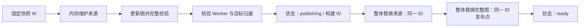

# 第 01 块：生命周期、数据模型与发布协议

本块交付数据类型、基线判定、发布恢复判定及业务接入规则。除新增独立模型模块外，现有 Compile、保存和查询行为尚未改变。本文区分代码已确认的事实、采用的协议和后续必须验证的存储前提。

## 1. 先看一个必须防住的案例

旧快照 A 的 `a.md` 引用 `old.md`，来源与图均已发布。用户改为引用 `new.md`，得到快照 B。Worker 将 B 的来源保存成功，但保存图失败。用户再恢复 A 的正文，得到快照 C。

此时 A → C 的正文 diff 可以为空，但磁盘来源仍是 B。直接套用这份来源会让图错误地引用 `new.md`。

因此，**来源与旧图必须共享同一构建 ID，才能作为增量基线**。给来源增加 `build_id`，不给它恢复顶层快照 ID：

- 来源与图的 `build_id` 相同且非空、解析器版本相同：允许进入增量流程，仍需校验记录完整性。
- ID 不同、为空、来源缺失或解析器版本变化：不能使用这份来源作为旧图基线。
- 普通更新遇到不可信基线：从固定目标快照重建来源和图，不使用失败轮次的缓存命中优化。
- Compile 遇到这种情况：可以核对当前快照的页面 OID，复用其批量发布阶段已经提取的记录；不匹配或缺失的页面才补读。

`build_id` 证明的是“两份派生数据一起构建”，`blob_oid` 证明的是“这页正文相同”。它们解决不同问题。

## 2. 代码核对结果与改动位置

| 已确认的现状 | 设计影响 | 代码依据 |
| --- | --- | --- |
| `versions_head` 是版本索引同步基线；完成失败任务、回滚也可能推进 | 不能直接让现有读写点沿用新语义 | [定义](file:///Users/bytedance/zhanghe/stu/OpenViking/openviking/service/compile_targets.py#L127-L128)、[完成释放](file:///Users/bytedance/zhanghe/stu/OpenViking/openviking/service/compile_targets.py#L1494-L1547)、[外部变更与回滚](file:///Users/bytedance/zhanghe/stu/OpenViking/openviking/service/compile_targets.py#L2285-L2367) |
| 普通写入没有统一拒绝运行中 Compile，甚至记录 `after_compile_snapshot` | “Compile 完成后才能编辑”需要服务层新约束 | [普通操作](file:///Users/bytedance/zhanghe/stu/OpenViking/openviking/service/compile_targets.py#L1907-L2004)、[写入元信息](file:///Users/bytedance/zhanghe/stu/OpenViking/openviking/service/compile_targets.py#L2495-L2517) |
| 部分恢复、删除入口已有运行检查，但范围和时机不同 | 不能用局部检查代替统一编辑准入 | [删除检查](file:///Users/bytedance/zhanghe/stu/OpenViking/openviking/service/compile_targets.py#L2603-L2637)、[单文件恢复](file:///Users/bytedance/zhanghe/stu/OpenViking/openviking/service/compile_targets.py#L2715-L2737) |
| `on_finish` 已持久化 `committing`、`target_head` 与 `snapshot_committed`，忙时返回运行态 | 能复用恢复入口，等待图时保留活动任务归属 | [完成流程](file:///Users/bytedance/zhanghe/stu/OpenViking/openviking/service/compile_targets.py#L1341-L1474)、[恢复入口](file:///Users/bytedance/zhanghe/stu/OpenViking/openviking/service/compile_targets.py#L1189-L1201) |
| 当前 JSON 保存直接调用 AGFS write，本地未加密 write 会截断旧文件 | 三份图业务文件需要完整对象替换，不能照搬普通 `write_json` | [JSON 保存](file:///Users/bytedance/zhanghe/stu/OpenViking/openviking/service/compile_targets.py#L270-L280)、[本地写入](file:///Users/bytedance/zhanghe/stu/OpenViking/crates/ragfs/src/plugins/localfs/mod.rs#L916-L952) |
| 底层已有本地、S3 的 `replace`，Python AsyncAGFSClient 尚无对应专用方法 | 第 03 块接通内部替换能力，并验证各部署后端 | [本地 replace](file:///Users/bytedance/zhanghe/stu/OpenViking/crates/ragfs/src/plugins/localfs/mod.rs#L1085)、[S3 replace](file:///Users/bytedance/zhanghe/stu/OpenViking/crates/ragfs/src/plugins/s3fs/mod.rs#L890-L918)、[Python 接口](file:///Users/bytedance/zhanghe/stu/OpenViking/openviking/pyagfs/async_client.py#L190-L278) |
| NamedQueue 是至少一次投递；普通 enqueue 没有按目标原子去重 | 第 07 块需要补齐跨实例 pending 去重；进程内字典不足 | [入队与 ACK](file:///Users/bytedance/zhanghe/stu/OpenViking/openviking/storage/queuefs/named_queue.py#L185-L224)、[消费](file:///Users/bytedance/zhanghe/stu/OpenViking/openviking/storage/queuefs/named_queue.py#L249-L279) |

## 3. 三份文件的契约

统一放在已有目标系统目录的 `artifact_graph/` 下：

```text
/local/{account_id}/_system/compile/target_folders/{sha256(normalized_to)}/
  state.json                         # 已有 Compile 目标状态
  artifact_graph/
    relation_sources.json
    artifact_relations.json
    artifact_relations_state.json
```

仅有三份新增业务文件。完整写入过程中使用的临时对象不保存业务历史、不参与查询或恢复判据；未发布临时对象可以清理。PathLock 的锁元数据沿用锁系统管理。

| 文件 | 字段 | 含义 |
| --- | --- | --- |
| 来源 | `schema_version`, `parser_version`, `build_id`, `pages` | `pages[uri] = {blob_oid, links}`；links 保存原始链接；空列表与缺少记录不同 |
| 图 | `schema_version`, `build_id`, `target_snapshot_id`, `generated_at`, `nodes`, `edges` | 完整图；目录节点 URI 以 `/` 结束；边为 `{from, to, type}`；时间内部使用 Unix 秒 |
| 状态 | `schema_version`, `status`, `target_snapshot_id`, `build_id`, `phase`, `compile_operation_id`, `attempts`, `pending`, `error` | 描述当前固定版本的建图、恢复和后续待处理工作 |

状态的业务状态仍为 `building / ready / failed`。`phase` 只细分 `building` 内部的 `queued / computing / publishing`，不增加对外状态。

- `target_snapshot_id`：本轮固定快照 W。执行期间的新编辑不能覆盖它。
- `build_id`：本轮随机构建 ID；入队尚未认领时可以为空，认领后确定。
- `compile_operation_id`：Compile 等待的任务归属；普通更新为空。等待依据仍在图状态文件中，operation 不增加建图字段。
- `pending`：本轮执行期间仍有后续工作，版本从目标 `wiki_head` 读取。它不证明消息已经可靠入队。
- `attempts / error`：对同一构建请求的重试次数及最终错误；重试中仍为 building，最终耗尽才为 failed。

模型负责字段形状，存储层负责合法状态转换，建图器负责 URI 规范化、节点完整性、边端点存在、排序和去重。当前模型不宣称已经完成这些后续校验。

## 4. 版本字段适配

目标语义确定如下：

| 字段 | 推进时机 | 不承担的职责 |
| --- | --- | --- |
| `wiki_head` | 普通修改、恢复、Compile 输出提交等导致目标快照推进时 | 不代表 Compile 已成功 |
| `versions_head` | 对应快照的图发布成功，Compile 最终成功时 | 不作为文件版本索引同步基线 |
| `version_index_head` | 现有索引同步、回滚调和流程所需时 | 不作为图 diff 基线 |
| 图的 `target_snapshot_id` | 图完整发布时 | 不跟着最新编辑立即推进 |

为了满足已约定的 `versions_head` 新语义，原来的索引基线需要改名为 `version_index_head`。第 08 块集中适配，当前不修改生产读写点。

迁移规则：为目标记录增加明确的格式版本。旧记录读入时，将旧 `versions_head` 映射为 `version_index_head`，新 `versions_head` 和 `wiki_head` 先为空；不能把旧值冒充最近成功 Compile。首次受锁写入时固化新格式。旧目标首次建图走全量；成功 Compile 后建立新语义。

必须覆盖 `new_record`、复活重置、目标移动、`_release`、`record_external`、`reconcile_rollback` 的读写点。快照 ID 只判等，不按哈希排序判断时间。普通修改通过下节的目标准入串行提交并登记，防止先提交的旧回调最后覆盖 `wiki_head`。

## 5. 编辑准入与新 Compile

需要一个按 `(account_id, normalized_to)` 获取的跨实例修改准入锁。其范围只覆盖同步修改、快照提交和可靠登记；不覆盖等待语义处理和整个 LLM 执行。复用 PathLock，不另建锁服务。

普通入口在准入锁内检查目标活动 Compile，检查和实际同步修改之间必须连续持锁。Compile 在同一准入锁内设置活动任务归属；它等待已开始的修改结束，之后拒绝新的普通修改。

入口覆盖单文件、批量、新增、删除、移动、复制、目录恢复、版本恢复、包发布；范围删除/移动必须检查所有重叠目标，而不仅是最近的 owning target。多个目标按稳定顺序批量获取准入锁。目标发现之后需在锁内复核其生命周期。

`edit_source="compile"` 是公开参数，不能作为绕过保护的授权凭据。Runtime 写入需要与当前活动 Compile 匹配的服务端可信身份；普通调用者标记 compile 不能获得例外。具体凭据传递在第 08 块核对 Runtime 请求链路后接入。

锁层次必须保持“准入 → 内容修改锁 → 元数据短锁”。Compile 设置活动归属后释放准入锁，完成流程再独立获取内容锁。不能持有目标 `state.json` 锁跨越整个写入，否则现有写入回调再次 `edit` 同一路径会死锁。

新 Compile 启动时，旧普通 Worker 可以继续计算，但发布时必须在目标与图状态的短锁内重新检查活动归属。若已出现活动 Compile，旧普通结果丢弃，不能覆盖 Compile 来源或图。Worker 下一次只处理已提交输出快照的 Compile；Runtime 尚未提交时等待，不能建工作区的中间图。

## 6. 发布点与状态恢复

准备阶段在内存完成来源维护、图增量更新和全量校验，不修改公开图文件。同一目标只允许一个 Worker 持有执行锁。发布阶段短暂获取目标状态、图状态、来源、图的协调锁，所有写入沿用有效 Lease。



**图文件的完整替换是发布点**。它成功之后，ready 状态写入失败属于状态收尾失败，不能将已经发布的图判为建图失败。

一致读取也经过发布短锁。读者不会看到正在写到一半的文件：

1. building、未到发布点：返回原来的完整图；首次无图返回尚未就绪错误。
2. 状态是 publishing，图 ID 与本轮 ID、快照均匹配：确认已发布，恢复 ready，然后使用图。
3. ready：状态与图的 ID、快照必须一致；不一致视为数据异常，进入恢复或报错。
4. 最终 failed：接口返回失败，旧图保留用于恢复或下一轮 diff；不能返回成功空图。

查询的恢复判定只需状态和图，不读来源或正文。Worker 和 Compile 轮询入口同样执行这项协调，避免“图已发布但 ready 未落盘”导致永久等待。若状态恢复仍遇到存储错误，明确返回/重试该错误，不伪造持久化 ready。

发布前后的网络错误可能意味着“写成功但响应丢失”。必须受锁重读目标对象确认 ID，不能依据异常直接判定未发布。已确认到达发布点的轮次不再重做来源更新。

临时文件整体替换解决文件完整性，不等于三文件事务。来源 ID 与旧图 ID 不一致时直接拒绝增量，允许下一轮全量恢复，避免为保留两套来源增加第四份业务文件。

## 7. Compile 等待

复用 operation 的现有 `committing`、`target_head` 和 `snapshot_committed`。Graph 的具体阶段放到任务展示的 `stage="building_graph"` 和图状态中；operation 不新增等待字段。

1. 正常产物最终批次成功写入时，收集最终 Markdown 字节的 OID 和 links；批次结束合并来源，先将来源 `build_id` 置空，表示它不再是旧图的一致基线。
2. Skill 包发布路径也要提供等价的最终字节提取。不能假装 Skill 已走普通 `batch_write`。
3. 完成阶段提交输出快照 W，持久化现有 operation 元数据；在目标与图状态协调锁内推进 `wiki_head=W`，登记 `compile_operation_id`、固定 W、queued 状态并可靠通知。
4. Compile 释放输出内容锁，退避轮询图状态。每次必须匹配 operation ID 与 W；旧图 ready 不能满足等待。
5. 图 ready 后完成原有版本和任务收尾，推进新语义 `versions_head=W`，释放活动任务归属。
6. 图最终失败则 Compile 失败，`versions_head` 不推进。输出已提交时沿用现有不回滚规则，保留 `wiki_head=W` 与 failed 状态；后续恢复不能假装输出未改变。

增量无变化分支不能绕过建图核验。已有对应完整图可以复用，但必须为当前等待归属登记 ready；没有对应图时仍需建图。取消沿用活动任务检查，未提交时回滚，已提交后不继续发布取消任务的候选图。

## 8. 执行中新修改与通知恢复

普通保存同步阶段只修改内容、推进 `wiki_head`、可靠登记通知，不解析正文、不写来源。

Worker 固定 W 执行。执行中新保存将 `pending=true` 并保留后续通知，不改本轮 W。Worker 发布 W 后，在释放执行权前受锁检查 pending 与当前 `wiki_head`；有后续变化则保持后续工作可消费，不能用 ACK 清除这项业务义务。

图状态中的 pending 是恢复依据，队列负责及时唤醒。登记顺序为先保存业务意图、再可靠入队，成功保存响应要求登记及入队完成。崩溃窗口由恢复扫描发现并补通知，扫描复用目标枚举能力。

第 07 块须实现队列按目标的原子 pending 去重，pending 消息转 active 时释放 pending 槽，从而允许“一个 active 加一个 pending”。普通 NamedQueue 的多次 enqueue 不能提供这个保证。补通知要以确定性目标键或后端原子操作防止重复；仅检查内存 pending 或先查后写不够。

重复投递仍可能发生；执行锁与已发布版本判等使重复通知不重复读取正文建图。failed 不由恢复扫描无限重试，新的内容请求或明确重试才能开启下一轮。

## 9. 故障推演

| 断点/并发场景 | 读者看到什么 | 恢复入口与结果 |
| --- | --- | --- |
| 来源已保存，图尚未替换 | building 时旧图；耗尽重试后查询失败 | Worker 检测来源 ID 不匹配旧图，普通更新从固定快照全量恢复 |
| 图已替换，ready 保存失败 | 协调读取确认 publishing ID 与图一致 | Worker / Compile 轮询 / 查询恢复 ready；不再次判成建图失败 |
| 来源污染后，用户恢复旧正文 | 不会因正文 diff 为空而错误复用来源 | `can_use_incremental_sources` 拒绝该基线，全量重建 |
| 等图期间普通保存 | 修改前拒绝，正文不变 | 服务层准入锁与活动任务复核 |
| 普通 Worker 计算中启动 Compile | Compile 期间仍保留旧已发布图 | 旧 Worker 发布复核发现归属变化，丢弃候选；转处理 Compile 固定 W |
| Worker 执行中新编辑到 W2 | 本轮发布前仍可读旧图，发布后可读 W | pending 与后续通知驱动 W2；检查完成与释放之间保持协调 |
| 入队成功但调用方未收到响应 | 不以失败响应推断消息不存在 | 原子目标去重、队列恢复和业务 pending 协同 |
| Lease 失效后旧 Worker 恢复 | 禁止其重新使用旧构建 ID 写正式对象 | 写前检查有效 Lease、归属；第 03/07 块注入失效与迟到 I/O 验证 |
| 目标删除并重建，旧任务迟到 | 新生命周期不接受旧候选 | 使用已有目标删除边界、活动归属和新构建 ID 复核 |

## 10. 本块实现与验证边界

新增 [artifact_relations_models.py](file:///Users/bytedance/zhanghe/stu/OpenViking/openviking/service/artifact_relations_models.py) 固化上述三份数据形状，提供两个无 I/O 判定：

- `can_use_incremental_sources`：来源与已发布图是否具有同一基线。
- `can_recover_publication`：当前 publishing 状态能否由完整图确认已发布。

[测试](file:///Users/bytedance/zhanghe/stu/OpenViking/tests/service/test_artifact_relations_models.py) 覆盖来源提前落盘后正文恢复、解析器变化、缺失来源、构建 ID / 快照错配、错误阶段的恢复拒绝，以及空 links 和边字段序列化。

验证结果：运行 `.venv/bin/python -m pytest tests/service/test_artifact_relations_models.py -q --no-cov`，11 项通过。已有依赖产生 6 条弃用警告。

这些测试验证决策规则，不验证持久化原子性或全链路。以下是进入对应施工块时的必要验收条件：

- 第 03 块：各实际后端完整替换、跨实例协调读取、临时对象清理、缓存可见性、未知写结果的重读确认。S3 copy 后删除临时对象失败不能掩盖已成功的正式对象替换。
- 第 03/07 块：现有 PathLock 在失效后能拒绝后续写入，但这不足以证明已发出的远程 I/O 不会迟到覆盖；必须验证或补齐后端条件写/提交保护后，才能宣称严格防止旧 Worker 覆盖。
- 第 07 块：补齐原子目标 pending 去重及恢复扫描，不把现有至少一次队列等同于已经满足去重协议。
- 第 08/09 块：可信 Compile 写入归属、覆盖全部修改入口的准入，以及版本字段迁移与取消/回滚验证。

下一块按计划实现 Markdown 原始链接提取与 Git blob OID。上述存储条件在后续对应模块落实之前，不将本块纯模型测试报告为线上发布协议已通过。
