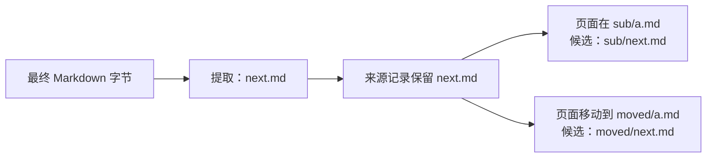

# 第 02 块：原始链接提取与 Git blob OID

本块只实现无文件系统访问的基础模块，尚未接入 Compile、普通保存或 Worker。普通保存时不会因本块新增同步解析。

## 1. 输入与输出

输入是最终成功保存的 Markdown 字节。输出是第 01 块的 `RelationSource`：

```text
输入字节：
  [下一页](../future.md#intro)

输出来源：
  blob_oid = Git blob OID
  links = ["../future.md#intro"]
```

`future.md` 当前是否存在，不影响来源记录。建图时再用这条链接与页面位置计算候选 URI，检查目标是否在固定快照中。

具体实现见 [artifact_relation_links.py](file:///Users/bytedance/zhanghe/stu/OpenViking/openviking/service/artifact_relation_links.py)：

| 函数 | 负责什么 | 不做什么 |
| --- | --- | --- |
| `git_blob_oid(content)` | 对原始字节计算 Git SHA-1 blob OID | 不解码、不改变换行、不提交快照 |
| `extract_relation_source(content)` | 按 CommonMark 提取链接目标并生成来源记录 | 不解析路径归属、不检查目标存在性、不读写存储 |
| `resolve_relation_link(source_uri, href, target_root=...)` | 用页面位置解析目标目录内的候选 URI | 不建立边、不执行 ACL 检查、不读取目标 |

## 2. 原始链接为什么单独保存

如果 `sub/a.md` 中写了 `[下一页](next.md)`，来源始终保存 `next.md`：



普通链接、引用式链接和自动链接均按 Markdown 语法提取。图片、行内代码、代码块、原始 HTML 链接和未使用的引用定义不作为页面链接。重复目标按首次出现顺序去重。

“原始”指 Markdown 语法解析后的目标：转义和 HTML 字符实体已经解码，但 Unicode、空格、百分号编码、相对路径及锚点不被提前改写。外部链接、纯锚点和断链也留在来源中；前两者在解析候选 URI 时被过滤。

采用独立的 `MarkdownIt("commonmark")` 解析器；不复用负责资源分块和写入的 MarkdownParser。解析器没有跨请求页面缓存。`PARSER_VERSION="markdown-v1"` 标记此套提取规则，规则改变时需要推进版本。

Markdown 字节使用严格 UTF-8 解码，失败明确抛出异常，不把替换字符当作成功提取结果。OID 自身可对任意字节计算。

## 3. 路径解析规则

| 链接 | 处理 |
| --- | --- |
| `../next.md` | 相对来源页面的父目录解析 |
| `/resources/wiki/next.md` | 相对当前 account 的 Viking 命名空间根解析 |
| `viking://resources/wiki/next.md` | 保留显式 Viking 路径 |
| `next.md#intro` | 分离锚点，只解析文件路径 |
| `a%23b.md#intro` | 分离真实锚点后解码，文件名为 `a#b.md` |
| `a%20b.md` | 解码后复用 `normalize_storage_target_uri`，得到 `a_b.md` |
| `next.md?view=1` | 查询参数不参与路径定位 |
| `https://...`、`//example.com/...`、`#intro` | 不生成候选目标 |
| 指向 target 外部、编码分隔符或不安全路径 | 不生成候选目标 |

候选 URI 不携带目录末尾 `/`。第 05 块按快照节点清单确认文件或目录，再映射为图中实际节点 ID；不会仅凭链接拼写猜测节点类型。

调用方必须传入规范化的来源 URI 和目标范围。来源页面本身不属于该目标是调用错误，抛出 `ValueError`；不合法的用户链接只产生 `None`，不会阻止其他有效链接解析。

## 4. 内容标识与底层验证

Git blob OID 是：

```text
SHA1("blob " + 字节长度的十进制文本 + NUL + 原始字节)
```

它不同于正文直接做 SHA-1。长度必须是字节数，中文不能用字符数代替；CRLF、LF、BOM 或其他字节变化都会影响 OID。

Python 使用标准库 `hashlib` 分别更新头部与正文，不为拼接再复制整份正文。本块未增加公开 Rust/Python 哈希接口。底层仍使用 `gix_object::compute_hash(Sha1, Blob, data)`，两端通过实际快照提交进行一致性验证。

新增的 [原生验证用例](file:///Users/bytedance/zhanghe/stu/OpenViking/tests/agfs/test_git_binding.py) 使用隔离临时目录，调用现有 Rust binding 写入、提交和读取 Blob，对比其 OID 与 `git_blob_oid`。覆盖空内容、普通文本、中文、CRLF 和二进制字节。

## 5. 验收与接入边界

[专项测试](file:///Users/bytedance/zhanghe/stu/OpenViking/tests/service/test_artifact_relation_links.py) 覆盖 Markdown 语法、原始目标保留、页面移动、编码路径、范围过滤及调用错误。

最终验证：38 项链接与路径用例、11 项第 01 块模型用例、5 项实际 Rust Blob OID 用例，共 54 项通过。Ruff 静态检查、新增模块格式检查、`git diff --check` 和 `uv lock --check --offline --quiet` 均通过。

本块沿用已安装和已锁定的 `markdown-it-py`，在 `pyproject.toml` 中声明为直接依赖；锁文件只增加该直接依赖关系，没有升级现有包。

后续接入仍按既定方案：

- Compile 在 batch 内使用最终成功保存的字节提取，批次结束统一持久化。
- 普通产物修改同步阶段只登记并通知；Worker 从固定快照读取变化页面后提取。
- Worker 加载来源、维护来源，再更新受影响节点与边；断链目标后来出现时重新利用原始链接。
- 不引入旧 PR 的跨请求来源字典、进程内 Compile 建图任务或查询等待。
