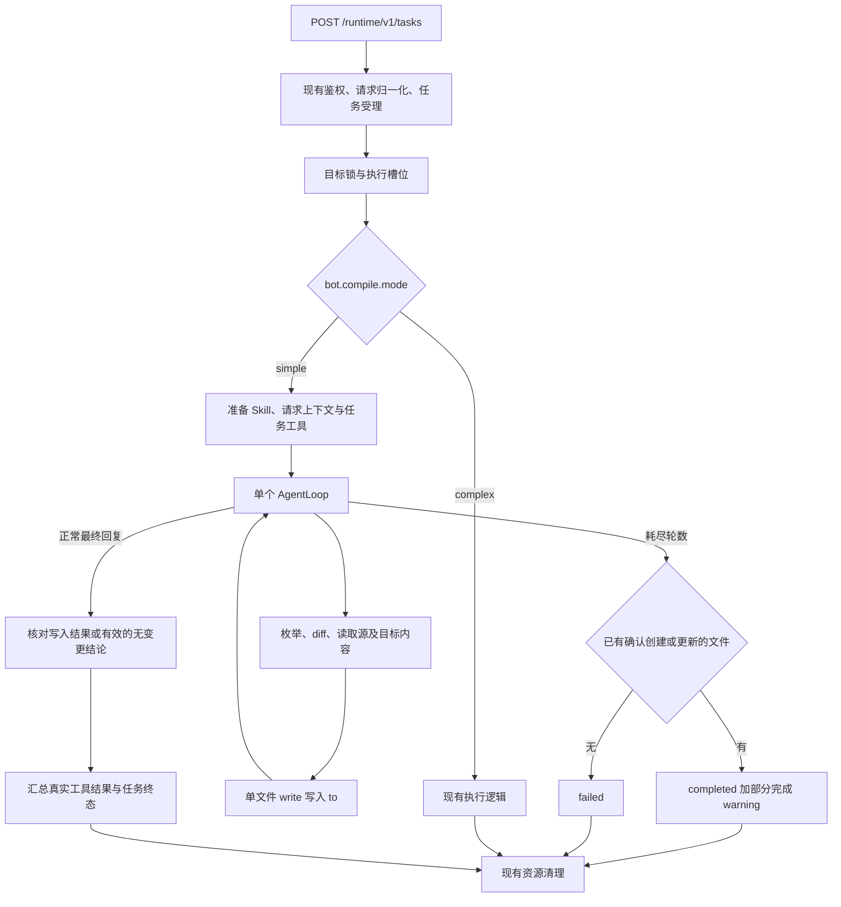

# VikingBot Compile simple 模式实施计划

## 1. 目标与完成标准

文档状态为待评审。目标读者为 VikingBot、Compile 和商业版 Runtime 的维护者。交付目标是在 VikingBot 内增加默认的 simple 执行模式，使用一个 AgentLoop，根据 Skill 和 instruction 读取输入，并通过 OV 单文件 write 逐次写入目标目录。

| 项目 | 约定 |
|---|---|
| 配置入口 | `bot.compile.mode`，取值为 `simple`、`complex`，默认 `simple` |
| simple | 一个 AgentLoop，任务提示词、OV 读取工具、单文件写工具和普通最终回复 |
| complex | 显式配置后执行现有分支，包括 direct、planner/pipeline 和现有 memory 路径 |
| 全量与增量 | 使用请求中的 `args.changes.execution.mode`，兼容已有 `last_compile_time` 输入 |
| 轮次耗尽 | 至少一个目标文件已确认创建或更新时，返回 `completed` 并在 `result.warnings` 标明部分完成。零产出时返回 `failed` |
| 修改范围 | 实现、测试、说明文档均位于 `bot/` |

验收要求包括默认值生效、complex 回归通过、全量与增量可完成真实编译、逐次写入可观测、失败与取消状态准确，以及公共内核和商业版接口契约回归通过。

## 2. 已确认事实与证据

以下依据为当前本地源码。线上部署版本与实际 Runtime 地址属于独立验证项。

| 已确认事实 | 证据路径 | 结论与建议范围 |
|---|---|---|
| Runtime 创建接口将请求交给 `BotCompileService.create_task` | [compile/router.py](../../../vikingbot/compile/router.py) | mode 分流放在 service，继续使用现有创建、状态和取消入口 |
| `CompileConfig` 已集中保存 Map、Shuffle、Reduce 参数 | [config/schema.py](../../../vikingbot/config/schema.py) | 在该模型增加 mode 默认值与枚举校验 |
| service 已负责身份、幂等、目标锁、任务状态、沙箱和模型并发 | [compile/service.py](../../../vikingbot/compile/service.py) | simple 复用该生命周期 |
| 底层 `_run_agent_loop` 支持独立提示词、工具集和终止工具 | [agent/loop/loop.py](../../../vikingbot/agent/loop/loop.py) | simple 可直接调用现有循环 |
| `run_structured_task` 的提交检查绑定 `submit_wiki_bundle` | [agent/loop/loop_tools.py](../../../vikingbot/agent/loop/loop_tools.py) | simple 使用底层 loop，按最终回复或预算耗尽的退出分支判定结果 |
| Bot 的 `write_file` 写入任务工作区 | [agent/tools/filesystem.py](../../../vikingbot/agent/tools/filesystem.py) | simple 需要把 SDK 的 OV write 暴露为任务工具 |
| OV SDK 已提供单文件 `write(uri, content, mode)` | [SDK client.py](../../../../sdk/python/openviking_sdk/client.py) | Bot 增加薄适配，继续调用已有 HTTP 单文件接口 |
| OV diff 工具已有分页；list 的模型参数没有 offset | [agent/tools/ov_file.py](../../../vikingbot/agent/tools/ov_file.py) | 复用 diff；补充目录分页并保留已有调用的默认行为 |
| 当前 Skill 目标通过整包校验及 `add_skill` / `update_skill` 发布 | [compile/service.py](../../../vikingbot/compile/service.py) | Skill 产物的支持范围列为评审项，避免把普通写入等同于完整安装 |
| 内核管理开始/结束快照与失败回滚 | [compile_targets.py](../../../../openviking/service/compile_targets.py) | simple 提供真实 Runtime 状态，由内核完成收尾 |

内核在成功收尾时将本次输入快照保存为 `source_commit`，将请求的全部 `from` 保存为 `processed_roots`。下次增量按源快照间的变化选取输入。Runtime 的 warnings 不参与这两个判断。现有 complex 已有将部分产出作为 completed 并附 warnings 的路径。详见 [内核增量计划与基线](../../../../openviking/service/compile_targets.py) 和 [Bot 完成分支](../../../vikingbot/compile/service.py)。

### 2.1 待确认的边界

| 边界 | 当前证据与影响 | 建议 |
|---|---|---|
| `to` 指向 Skill 包 | 现有发布带有整包校验与安装语义；单文件 write 是否满足目标命名空间及索引要求需要专项核对 | simple 首版支持资源和 memory 目标；Skill 产物使用显式 complex。该支持范围变化需要评审确认 |
| 受管目标的版本记录 | 普通 write 默认采用 manual 来源，有版本服务时会走普通编辑记录路径 | 集成验收核对实际操作记录、成功快照及失败回滚；单文件回执确认正文写入，索引刷新异步完成 |
| 外部并发编辑 | 单文件 write 请求没有 `expected_sha256` 字段 | 沿用接口的覆盖语义和 Bot 目标锁，明确该锁只协调当前服务内的 Compile；额外的跨客户端并发编辑仍存在覆盖风险 |

## 3. 配置与兼容行为

推荐配置示例采用以下结构。

```json
{
  "bot": {
    "compile": {
      "mode": "simple",
      "map_concurrency": 30,
      "shuffle_concurrency": 20,
      "reduce_concurrency": 30
    }
  }
}
```

| 输入 | 预期行为 |
|---|---|
| 省略 compile 或省略 mode | simple |
| `mode="simple"` | simple，Map/Shuffle/Reduce 的并行参数仅在 complex 执行时使用 |
| `mode="complex"` | 当前 complex 执行行为 |
| mode 为其他值或 null | 配置校验报错 |
| 旧配置只包含并发参数 | 升级后使用 simple；需要现有执行行为的部署应显式配置 complex |

`bot.compile.mode` 选择执行器，`args.changes.execution.mode` 选择本次全量或增量的输入范围。任务受理时将生效的执行器模式写入现有 `task.meta`，便于查看实际行为。相同幂等键继续返回已经存在的任务。

## 4. 执行流程



simple 分支尽早进入自身输入准备逻辑，避免全量场景先由 service 枚举完整文件清单。Skill 主文件由 runtime 读取并放入提示词，附件由 Agent 按需读取。请求中的 Skill snapshot 继续经现有 connection 传递。

### 4.1 全量提示词

提示词必须包含以下信息，并使用结构化序列化传入用户字段。

| 信息 | 行为要求 |
|---|---|
| 编译类型 | 明确这是一次全量编译，全量覆盖本次 from 的输入 |
| from、to | from 为读取范围，to 为输出根目录；允许按目录逐页枚举并边读边写 |
| Skill 与 instruction | Skill 正文、Skill 根 URI 与用户指令共同定义产物；附件引用按需读取 |
| 已有目标 | 更新前读取相关内容，保留与本次任务无关的有效内容 |
| 完成条件 | 处理完所需输入、确认所有必要写入后直接回复结果；有未解决错误时说明失败 |

完整扫描输入不自动意味着清空目标目录。具体产物组织和更新策略由 Skill 与 instruction 定义。

### 4.2 增量提示词

在全量提示词的通用信息之外，补充 `base`、`head`、`full_dirs`、`diff_dirs` 及 `execution.mode`。

| 输入 | Agent 行为 |
|---|---|
| full_dirs | 完整读取这些新增或要求全量处理的目录 |
| diff_dirs | 使用固定 base/head 调用 diff，翻页直到结束 |
| added / modified | 读取必要源内容，并读取受影响的已有目标，更新相关产物 |
| deleted | 根据目标中的引用和内容判断影响，通过重写文件清除失效内容；需要物理删除整个目标文件时，报告工具能力不足 |
| 变更集合为空 | 可以明确以无变更完成 |

diff 比较的是传入的快照，普通读取沿用当前 OV read 的语义。源文件在执行期间发生变化时，不能承诺读取内容严格对应 head。

### 4.3 兼容已有调用

优先采用 `changes.execution.mode`。缺少 changes 时，保留当前 instruction 与 `last_compile_time` 的优先关系。有截止时间的旧请求复用现有文件筛选逻辑，把选中的文件交给 simple；其他请求按全量处理。没有候选源的旧增量请求沿用提前完成行为。

## 5. 任务工具与单文件写入

### 5.1 工具集合

| 工具 | 来源与职责 |
|---|---|
| openviking_list | 复用现有工具，补充 offset、limit 参数供逐页遍历 |
| openviking_multi_read | 读取 from、to 与 Skill 附件，保留范围读取能力 |
| openviking_grep / openviking_glob | 查找相关源文件、已有目标和引用 |
| openviking_diff_paths | 增量时注册，绑定本次 diff_dirs 与 base/head，避免模型自行选择比较版本 |
| openviking_write | 使用当前请求身份写入 to 下的单个文件 |

单个 loop 通过上述工具完成任务。必要的上下文压缩和模型调用限额复用现有实现。Skill 如果要求当前工具集之外的能力，任务返回具体缺失能力，避免把缺失产物记成成功。

### 5.2 openviking_write

工具参数为目标相对路径、文本内容和 `mode`，mode 支持 `replace`、`append`，默认 `replace`。底层每次调用一次 SDK `write(uri, content, mode=mode)`，使用请求认证身份，省略 `options`。

写入路径通过现有相对路径验证与 URI 拼接函数构造，限定在当前 to 下。拒绝绝对 URI、路径穿越和受保护的派生文件。服务端继续执行 ACL 与命名空间校验。

沿用 SDK 默认的 `wait=False`。正文提交后继续下一步，索引等后续处理可异步完成。复用 Bot 已有目标锁与服务端单文件写锁。有先后依赖的写操作分轮调用。append 遇到响应不确定时需要读取核实，避免自动重试产生重复内容。

### 5.3 结果与失败记录

沿用 `CompileResult` 和现有 task.meta 容器。真实写入列表来自工具记录。服务端未提供 created/updated 分类时，在首写前检查文件是否存在，据此汇总 created 或 updated；该分类存在外部并发写入时的竞争窗口。

成功写入路径按 URI 去重，任务内新建后再次修改仍计入 created。对确认内容相同的替换操作可记录 unchanged。page_count 使用去重后的成功目标文件数；link_count 的精确统计能力为待确认，默认值不能作为已检查链接的证明。

每次写入回执后持久化必要的输出进度到 task.meta。失败、取消时仍可看到已确认写入的路径以及回执不确定的写入，任务终态由现有生命周期管理。记录只包含必要 URI、状态及脱敏错误信息。

### 5.4 最终回复与轮次耗尽

simple 复用普通 AgentLoop 的最终回复分支。在 Bot 内给该循环增加仅 simple 启用的严格结束判断，沿用现有返回结构和其他调用方的默认行为。模型正常结束、返回非空正文且本轮没有工具调用时退出；写入结果或有效的无变更结论通过检查后记为 completed。最后一轮也适用。

当循环自然耗尽预算时，在生成聊天兜底文本前向 simple 执行器报告耗尽。执行器依据工具回执决定终态，最后一轮本身可以产生有效产出。

| 退出原因 | Runtime 状态与结果 |
|---|---|
| 自然结束，任务完成或确认无需变更 | `completed`。正常的增量无变更可以是零写入 |
| 仅因轮次耗尽结束，已有确认创建或更新的目标文件 | `completed`。返回已确认的目标 URI，将部分完成说明放入 `result.warnings` |
| 轮次耗尽，只有读取、未变化文件、失败写入或回执不确定 | `failed`。说明耗尽且没有确认产出 |
| 模型错误、截断、未解决的执行错误 | `failed`。保留具体错误和已确认写入记录 |
| 用户取消 | `cancelled`。取消优先于部分完成 |

部分完成 warning 使用去重后的目标文件数，例如“已达到最大轮数，部分编译完成，已写入 80 个目标文件。后续增量可能跳过本次未处理且未变化的源。需要重新覆盖全部输入时，请发起全量编译。”输出文件数只表示已交付的文件数量，输入覆盖率未知。

对于经 `/api/v1/compile` 发起的任务，部分完成会按成功提交到 `to`。内核会推进该触发方式的增量基线。相同 Skill 和 instruction 下，源没有新变化时，下一次增量可能在内核直接完成。显式 `args.mode="full"` 可重新扫描全部输入；相同预算仍可能再次耗尽。断点续编和逐文件补齐没有现成的内核进度语义。

### 5.5 取消与可见性

任务写入期间保持 running，取消接口可中断 loop。取消确认之后，工具入口阻止新的写入。已发出的 HTTP 写请求可能已经到达服务端，客户端取消无法保证撤销该请求。

边读边写使中间产物可见。内核收到 failed 或 cancelled 时，在当前任务已有起始快照且尚未提交结束快照的条件下，尝试恢复 to 的起始版本。直接调用 Bot Runtime 的任务可能保留部分输出，status 中应提供已确认写入进度；Bot 对整次任务原子回滚的能力不作承诺。

## 6. 修改文件与预期产出

| 文件 | 类型 | 修改内容 | 预期产出 |
|---|---|---|---|
| `bot/vikingbot/config/schema.py` | 修改 | mode 枚举与默认值，更新 CompileConfig 注释 | 配置可校验，旧配置默认 simple |
| `bot/vikingbot/compile/service.py` | 修改 | 选择执行器、接入 simple、传递上下文、持久化 mode 与结果进度 | 现有任务生命周期覆盖两种模式 |
| `bot/vikingbot/agent/loop/loop.py` | 修改 | 为 simple 提供按实际退出分支判断异常与耗尽的可选行为 | 保留普通聊天现有的兜底回复 |
| `bot/vikingbot/compile/simple.py` | 新增 | 提示词、任务工具、单个 loop、结束校验和输出记录 | 自包含的 simple 执行实现 |
| `bot/vikingbot/openviking_mount/ov_server.py` | 修改 | 单文件 write 薄适配，复用 SDK 和请求身份 | simple 可调用已有 OV 单文件接口 |
| `bot/vikingbot/agent/tools/ov_file.py` | 修改 | 为 list 增加模型可用的分页参数，保持原有默认调用行为 | 大目录可以完整枚举 |
| `bot/tests/test_compile_simple.py` | 新增 | 配置、分流、提示词、工具与任务状态用例 | simple 行为及关键失败路径自动验证 |
| `bot/tests/test_openapi_auth.py` | 按需修改 | 新默认值适配及 Runtime 契约断言 | 创建、状态、取消与身份隔离回归 |
| `bot/README.md`、`bot/README_CN.md` | 修改 | 默认模式、显式 complex 示例、部分完成 warning、增量遗漏与全量重扫 | 开源用户可直接配置和判断结果 |

simple 专用工具先集中在 `simple.py`，随文件实际规模再评估是否需要拆分。新增关键实体、方法及有业务语义的字段遵循仓库注释规范。

允许的实现修改路径为 `bot/`。评审 diff 应验证公共内核、SDK、商业版 Go 服务及部署配置的文件集合均为零改动。现有 router、共享 AgentLoop 默认行为及 Tool factory 纳入回归验证。

## 7. 商业版链路的验证依据

商业版代码将 Collection 的 `compile_api.base_url` 指向 Go KernelAPI，Go Runtime 创建 Managed Agents Session，status 查询 Session，cancel 发送 user.interrupt。公共内核承担快照、输入变更计划及任务收尾。

| 验证对象 | 验收要求 |
|---|---|
| mode 的读取范围 | `bot.compile.mode` 仅控制 Python VikingBot 执行器 |
| Runtime 协议 | 创建继续返回 session_id；状态与取消继续使用现有请求及终态枚举 |
| 写接口 | 使用既有 content/write，省略 options，确认受管目标上的版本归属 |
| 公共内核 | 开始/结束快照、增量基线与失败回滚相关测试通过 |
| 商业版路由 | 现有 Go Runtime 的 Start/Status/Cancel 仍是商业版执行入口 |

配置成 Python VikingBot Runtime 的部署会采用新的默认值。标准商业版的影响判断以其实际 base_url 为准。

## 8. 验证计划

### 8.1 自动化用例

| 类别 | 关键用例 |
|---|---|
| 配置与分流 | 省略 mode、simple、complex、非法值；显式 complex 进入原有各类目标分支 |
| 全量与分页 | 多页目录和嵌套目录；读取第一份源后即可写入，再继续读取其他源；所有写调用均为单文件 write |
| 增量与兼容 | full_dirs 与 diff_dirs 混合、diff 多页、删除来源、零变更、旧 last_compile_time、Skill snapshot 传递 |
| 写入边界与结果 | 创建、覆盖、追加、重复写同一路径、路径穿越、ACL 拒绝、部分失败、异步回执或超时的不确定状态 |
| 生命周期 | 明确完成、无变化完成、未解决错误、模型失败或截断带正文、末轮正常回复、耗尽且有确认产出时 completed 并附 warning、耗尽且零产出时 failed、取消发生在读取/写入期间、同幂等键重复提交、身份隔离 |

使用可控的假 provider/client 验证循环和工具调用顺序，检查 simple 执行全过程不会调用 planner/pipeline 或 batch_write。测试以现有接口行为为断言，避免依赖自然语言提示词的整段精确匹配。

### 8.2 计划执行命令

以下命令从仓库根目录执行，属于实施阶段待执行项。

```bash
PYTHONPATH=bot .venv/bin/python -m pytest -c bot/pytest.ini bot/tests/test_compile_simple.py bot/tests/test_compile_sources.py bot/tests/test_openapi_auth.py bot/tests/test_agent_loop_outcome.py

PYTHONPATH=bot .venv/bin/python -m pytest tests/server/test_bot_proxy_auth.py tests/server/test_compile_studio.py

.venv/bin/python -m ruff check bot/vikingbot/config/schema.py bot/vikingbot/compile/service.py bot/vikingbot/compile/simple.py bot/vikingbot/agent/loop/loop.py bot/vikingbot/openviking_mount/ov_server.py bot/vikingbot/agent/tools/ov_file.py bot/tests/test_compile_simple.py bot/tests/test_openapi_auth.py

.venv/bin/python -m ruff format --check bot/vikingbot/config/schema.py bot/vikingbot/compile/service.py bot/vikingbot/compile/simple.py bot/vikingbot/agent/loop/loop.py bot/vikingbot/openviking_mount/ov_server.py bot/vikingbot/agent/tools/ov_file.py bot/tests/test_compile_simple.py bot/tests/test_openapi_auth.py

git diff --check
```

若现有用例受外部依赖或环境影响，应记录具体命令、失败栈及基线复现结果，区分测试环境问题和此次引入的回归。

### 8.3 真实模型验证

在独立测试目标目录执行以下场景，记录输入、task_id、状态、实际文件和模型用量。

| 场景 | 检查结果 |
|---|---|
| 多源全量 | 目标内容符合 Skill/instruction；日志显示读写交替；产物与源内容一致 |
| 修改源后增量 | 相关内容被更新，其他有效目标内容保留 |
| 删除源或增加源目录 | Agent 正确处理 deleted 和 full_dirs |
| 有产出时耗尽轮数 | 从内核入口运行，核对目标文件及 warning；保持源不变再跑增量，验证遗漏的源不会因 warning 被补选；再显式发起全量，核对重新枚举 |
| 中途取消 | status 到达取消终态，记录已写文件；通过内核发起时检查最终回滚结果 |
| 真实 complex 失败样例 | 使用相同输入在 simple 下重跑，检查内容完整性及成功率，防止仅凭终态判定改进 |

模型与测试环境可用性在执行时确认。自动化测试成功和真实模型验证成功分别报告。

## 9. 实施顺序与最终交付

1. 完成评审项确认，优先确认 Skill 产物范围和普通 write 在受管目标上的版本归属。
2. 加配置默认值及分流测试，显式 complex 的回归先通过。
3. 接通 OV write 与目录分页，实现 simple 的提示词、工具和单个 loop。
4. 完成增量兼容、结果记录、错误与取消测试。
5. 执行相关测试、真实模型验证及差异范围检查，更新中英文使用说明。

最终交付包含以下四项。

| 交付物 | 内容 |
|---|---|
| VikingBot 实现 | 默认 simple、可选 complex、OV 单文件 write 与全量/增量执行 |
| 自动化验证 | 配置、正常执行、失败、取消及 Runtime 协议回归结果 |
| 使用说明 | 配置示例、迁移行为、输出范围、部分完成和全量重扫方式 |
| 验收摘要 | 修改文件、真实任务产物、执行命令、待确认项及已知限制 |

方案对 simple 稳定性的判断仍需真实任务验证。主要已知限制为单 Agent 处理大任务的轮次与上下文预算、单文件写入耗时、中间产物可见、跨客户端编辑覆盖，以及 Skill 产物支持范围待评审。
