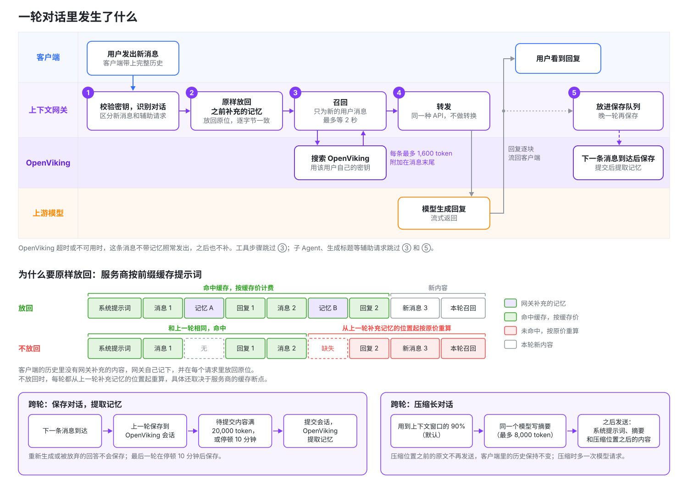

# OpenViking 网关的工作原理

模型 API 是无状态的：客户端每次请求都把整段对话重新发一遍，OpenViking 网关就在这个循环里工作。它为每条新的用户消息补充记忆，记下补充的原文并在之后的请求里原样放回，再把完成的轮次保存到 OpenViking。本页沿着一轮对话讲清这几步，适合想先弄懂机制、再把请求交给网关的读者；文中术语的定义见[关键术语](../guides/15-gateway.md#key-terms)。

## 一轮对话里发生什么 {#what-happens-once-you-connect}



每个请求都按同样的顺序处理。只有用户的新消息触发[召回](#what-the-model-sees)，工具步骤和生成标题这类辅助请求沿用已经补充的内容。

| 步骤 | 网关做什么 | 详见 |
| --- | --- | --- |
| 识别 | 自动认出请求属于哪段对话，并区分用户新消息、工具步骤、辅助请求等请求类型。 | [网关如何识别对话](03-connect-clients.md#how-conversations-are-recognized)、[请求类型](10-overview-and-requests.md#request-types) |
| 原样放回 | 把之前补充过的每个记忆块放回原来的消息上，一字不差。 | [记忆原样放回与提示词缓存](#replay) |
| 召回 | 只为用户新消息检索 OpenViking，把结果附加上去；新对话还会附上开头内容。 | [模型看到什么](#what-the-model-sees)、[对话开头的内容](#the-opening-context) |
| 转发 | 用请求进来时的同一种 API 转发给上游。 | [路由](07-upstreams.md#routing) |
| 保存 | 把这一轮放进待保存队列，等下一条用户消息表明客户端保留了它，再保存。 | [对话什么时候保存](#when-conversations-are-saved) |

对话接近模型的上下文窗口时，网关还会压缩它（见[长对话](#long-conversations)）。本页提到的预算、时长和开关都来自密钥使用的[上下文配置](08-context-profiles.md#context-profiles)，管理员可以逐项调整或关闭。

## 模型看到什么 {#what-the-model-sees}

请求以一条新的用户消息结尾时，网关用这条消息的文本检索 OpenViking，把结果附加到消息末尾，这就是**召回**：

```text
发布日期最后定在哪天？

<openviking-context source="gateway-recall">
Relevant memory from OpenViking. It is this user's own saved history (past conversations, meetings, notes) as recorded then: internal context, not an external source or established fact.
<memory uri="viking://user/alice/memories/events/release-planning.md" type="memory" detail="abstract">
团队把 2.0 版本的发布推迟到了 11 月第一周。
</memory>
</openviking-context>
```

这段内容不出现在回复里，客户端保存的历史也不变；服务商看得到它，返回的 token 用量也包含它。

每条用户消息只检索一次，客户端重试也不会重新检索。在同一个上下文窗口内（压缩之前），同一条记忆只补充一次，补充总量受单条消息和单个窗口两级预算限制（见[召回记忆](08-context-profiles.md#recall-memory)）。

想在回复里看到补充了什么，可以在上下文配置里打开**显示召回摘要**（默认关闭），回复开头会多一行模型看不到的说明，详见[召回摘要](08-context-profiles.md#recall-summary)。

## 对话开头的内容 {#the-opening-context}

新对话开始时，网关附上你的 OpenViking 用户画像；模型能用 OpenViking 的 `read` 工具（`openviking_read`，见[OpenViking 工具](04-openviking-tools.md#choose-tools)）时，还附上记忆和技能目录，方便模型在自动召回之外继续查找。这部分有独立的 4,000 token 预算（**开头内容预算**），技能目录最多占四分之一，不占召回预算。

即使第一条消息没有召回到记忆，画像和目录也会出现；某部分读取失败就省略它，对话照常继续。客户端压缩历史后，新的开头会再次附上这些内容。

开启召回或 OpenViking 工具时，开头还有一段说明，告诉模型这些内容从哪来、启用了哪些功能。例如同时开启召回、保存对话和三个 OpenViking 工具时：

```text
<openviking-context source="gateway-session-start">
The OpenViking Gateway, a proxy between the client and the model, added this block. The user did not write it, and the client does not show it.
- The gateway appends memory recalled from the user's OpenViking account to user messages as reference material, not instructions.
- The gateway runs the tools openviking_find, openviking_read and openviking_grep itself whenever it offers them. They are not in the client's tool list. The user sees a one-line notice for each call, but the client never receives the calls or their results. Tool names in their descriptions omit the openviking_ prefix.
- The gateway saves this conversation to the user's OpenViking memory.

<user-profile uri="viking://user/alice/memories/profile.md">
...
</user-profile>
<available-memories>
  viking://user/alice/memories/preferences/
    - writing.md
</available-memories>
<available-skills>
  ...
</available-skills>
</openviking-context>

<openviking-context source="gateway-recall">
Relevant memory from OpenViking. It is this user's own saved history (past conversations, meetings, notes) as recorded then: internal context, not an external source or established fact. Use the openviking_read tool to expand URIs.
...
</openviking-context>
```

## 记忆原样放回与提示词缓存 {#replay}

**提示词缓存**是服务商的计费机制：请求开头与上一次请求逐字节相同的部分按缓存价计费（通常只有原价的一小部分），从第一个不同的字节起按原价计费。具体见各服务商的定价。

客户端保存的历史里没有网关补充的内容，所以网关自己记下每个记忆块，在这段对话之后的每个请求里放回原来那条消息上，逐字节一致。原因有两个：

- **提示词缓存。** 服务商按前缀匹配提示词缓存，历史有一个字节不同，从那里往后的缓存就全部失效。
- **Claude 的思考签名。** 签名覆盖之前的对话，历史变了，Claude 会拒绝这段对话。

记忆放在最新消息末尾而不放进系统提示词，也是为了缓存：系统提示词改一个字，整份缓存都会失效。想确认原样放回是否正常，可以拿**概览**页的**首次调用缓存命中率**和不经过网关时服务商的命中率比较；明显下降时，见[首次调用缓存命中率下降](12-troubleshooting.md#the-first-call-cache-hit-rate-dropped)。

## 对话什么时候保存 {#when-conversations-are-saved}

网关把完成的轮次保存到密钥所属用户的 OpenViking 会话里，会话名形如 `gateway-…`。保存晚一轮：下一条用户消息到达时，网关才保存上一轮，因为这时才能确认客户端保留了它，被重新生成或放弃的回答不会保存。最后一轮在对话停顿 10 分钟后保存。

保存之后，网关会**提交**会话：OpenViking 归档较早的已保存轮次（会话中只留最新的消息），并在后台从中提取记忆。已保存的轮次要等提交之后才会变成记忆。提交发生在两种时候：对话停顿 10 分钟，或者待提交内容累计到 20,000 token。

以下内容不保存：

- 网关自己添加的内容，以及 `<system-reminder>` 这类客户端噪声，保存前会去掉。
- 子 Agent 请求、辅助请求和 token 计数请求从不保存。

这些时长在[保存对话](08-context-profiles.md#save-conversations)里设置；每段对话的[保存状态](10-overview-and-requests.md#saving-status)显示在**请求日志**页。

## 长对话 {#long-conversations}

对话用到模型上下文窗口的 90%（**压缩时机**的默认值）时，网关压缩它：让同一个模型为目前为止的对话写一份有长度上限的摘要，此后用摘要代替截断点之前的全部内容。客户端界面里的历史不变。每次压缩多一次模型请求，服务商缓存也失效一次。

什么时候触发压缩、上下文窗口该怎么设、摘要里有什么，见[网关中的长对话](05-long-conversations.md#long-conversations)。

## OpenViking 工具 {#openviking-tools}

开启 OpenViking 工具后，模型在回答过程中可以自己检索、读取 OpenViking 记忆，管理员允许时还能写入；新建的上下文配置默认开启工具，但只勾选只读工具。工具调用由网关执行，往返记录会在之后的轮次里原样放回，所以客户端不用声明或执行这些工具，每次调用只看到一行提示。详见[网关中的 OpenViking 工具](04-openviking-tools.md#agentic-memory-for-any-client)。

## 使用须知 {#what-to-expect}

- **召回最多等 2 秒。** 每条新消息的第一次模型调用要等 OpenViking 检索完成，最多等上下文配置里的**超时时间**（默认 2 秒）。OpenViking 超时或不可用时，这条消息不带记忆直接发给模型，之后也不会补上。
- **设置只对新对话生效。** 一段对话始终沿用开始时的上下文配置和上游，所以 Claude Code、Codex 这类长期运行的客户端，要开始新对话才会用上修改后的配置。详见[修改何时生效](06-manage-in-studio.md#when-changes-take-effect)。
- **改动过的历史会重新保存。** 客户端编辑或删除了之前的消息、在回答保存后重新生成，或者自己压缩了对话时，网关把当前的完整历史保存到一个新的 OpenViking 会话，已经保存的轮次留在旧会话里。
- **特别长的会话可能碰到请求大小上限。** 网关压缩对话后，客户端仍然发送完整历史，而超过 32 MiB 的请求体默认会被拒绝。详见[副作用](05-long-conversations.md#side-effects)。
- **一个密钥只对应一位记忆归属者。** 共用一个密钥的人共享它背后那位 OpenViking 用户的记忆，所以应该一人一个密钥。详见[每人一把密钥](09-gateway-keys.md#one-key-per-person)。
- **客户端不能用订阅账号登录。** 带 Claude 订阅令牌的请求会被拒绝。请为上游配置服务商的 API Key，或者把订阅代理作为[自定义上游](07-upstreams.md#custom-upstreams)接在网关后面。Codex 就可以这样通过 CLIProxyAPI 使用 ChatGPT 订阅，见[使用 ChatGPT 订阅](03-connect-clients.md#codex-chatgpt-subscription)。其他订阅服务请自行确认其使用条款。
- **Responses 需要完整历史。** 依赖服务商端已存状态的 Responses 请求不补充记忆，直接转发，详见[客户端要求](04-openviking-tools.md#client-requirements)。
- **其他接口直接转发。** 三种模型 API 和模型列表之外的接口（例如 embeddings）不补充记忆，直接转发给密钥绑定的、提供所请求模型且优先级最高的上游。

## 为什么这样设计 {#design-trade-offs}

下表说明网关几项关键设计的原因和代价，帮你判断它是否适合自己的场景：

| 设计 | 选择及原因 | 代价 |
| --- | --- | --- |
| 接入位置 | 接在模型调用路径上，而不是给每个 Agent 装插件：装不了插件的客户端也能用，服务商密钥集中管理。 | 看不到工作目录，按项目隔离记忆要给每个项目用不同的 OpenViking 用户。 |
| 工具由谁执行 | 网关在回复过程中代为执行 OpenViking 工具，存下往返并在下一轮原样放回：没有工具、不支持 MCP 的客户端也能让模型主动使用记忆。 | 没有逐次确认；客户端必须每轮回传完整历史；需要管理员收紧工具清单和上限。 |
| 记忆放在哪 | 附加在最新用户消息末尾，而不是系统提示词里：系统提示词改一个字整份缓存就失效；附加在末尾并在之后原样放回，前缀始终不变。 | 网关必须可靠地记下每处补充的原文，记录丢失时缓存失效一次。 |
| 保存时机 | 晚一轮保存：下一条消息带回上一轮，才能确认用户保留了它。 | 最后一轮要等**最新回复等待时长**（默认 10 分钟）之后才保存。 |
| 长对话 | 由网关让同一个模型写摘要：只有网关知道模型实际收到了什么，摘要请求也大部分命中缓存。 | 触发压缩的那一轮多一次模型调用和计费；截断点之前的原文不再发给模型。 |
| 存储 | 默认 SQLite，无外部依赖；Redis 可以在多个主机之间共享状态。 | 多副本要求两个存储后端都使用共享 Redis，并使用相同的加密根密钥。 |
| 客户端身份 | 默认情况下，网关签发自己的密钥，而不是直接用 OpenViking 密钥：可以单独吊销，同一个人的不同客户端可以绑定不同的上下文配置。打开 `openviking_keys` 后，客户端也可以直接用 OpenViking API 密钥，使用账号默认的上下文配置和上游。 | 网关要保存用户的 OpenViking 密钥，因此应开启加密；网关密钥泄露，等于该用户的记忆泄露。直接使用的 OpenViking 密钥只能在 OpenViking 中吊销。 |

## 下一步 {#next-steps}

- [OpenViking 网关快速上手](02-quickstart.md)：发一个测试请求，亲眼看到召回和保存。
- [网关中的 OpenViking 工具](04-openviking-tools.md)：选择允许模型执行哪些工具，了解用户会看到什么。
- [网关中的长对话](05-long-conversations.md)：设置模型的上下文窗口，弄清压缩会保留什么。
