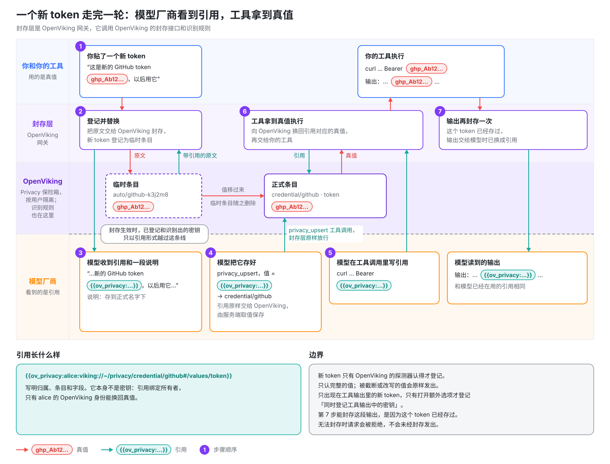

# 网关中的密钥封存

贴进对话的密钥会随这条消息发给模型服务商，之后的每个请求还会再发一遍。在上下文配置中打开**封存密钥**后，网关会在请求发往服务商之前，把用户已登记的密钥和用户新输入的 token 换成引用，例如 <code v-pre>{{ov_privacy:alice:viking://~/privacy/credential/github#/values/token}}</code>。模型在客户端工具调用里写下引用时，客户端收到的是真值。

在 Studio 中：**上下文配置** → 打开一份配置 → **封存密钥**。需要 OpenViking Server 0.5.7 或更高版本，见[打开封存](#turn-it-on)。

只有完整的已登记值和 OpenViking 探测器认得的 token 会被替换。工具输出里的新 token，只有打开**同时登记工具输出中的密钥**才会登记。封存默认关闭；打开后，无法封存的请求会被拒绝，不会未经封存发出，见[无法封存时](#when-sealing-cannot-be-done)。请求里已有的引用（例如客户端写下的 <code v-pre>{{ov_privacy:…}}</code> 片段）保持原样。

## 封存如何工作 {#how-sealing-works}

封存分两个方向。请求发给模型之前，网关把其中的文本交给 OpenViking，由它把已登记的值换成引用；客户端工具执行之前，模型写在参数里的引用会换回真值。助手正文从不启封，网关自己的记录里保留的也是引用。

引用写明了所有者、Privacy 条目和字段。它本身不是密钥：引用绑定所有者，只有这个所有者的 OpenViking 身份能把它换回真值。背后的接口见 [seal_privacy_texts()](../api/10-privacy.md#seal-privacy-texts)。

新 token 分两步处理：OpenViking 先以自动生成的名称把它存进 `auto` 分类，再请模型把它存到正式名称下。见[新 token](#new-tokens)。

## 打开封存 {#turn-it-on}

1. 确认 OpenViking Server 是 0.5.7 或更高版本，从这个版本起提供 `POST /api/v1/privacy-configs/seal`。只比较正式版本号，所以 `0.5.7.dev44` 这样的开发版也满足要求。
2. 在 Studio 中：**上下文配置** → 网关密钥使用的那份配置 → 打开**允许客户端覆盖设置**下方的**封存密钥**。
3. 按需打开它下方的开关。

| Studio 名称 | API 名称 | 默认值 | 作用 |
| --- | --- | --- | --- |
| **封存密钥** | `seal_secrets` | 关闭 | 把用户已登记的密钥和用户新输入的 token 换成引用，并让客户端工具拿到真值。 |
| **同时登记工具输出中的密钥** | `enroll_tool_secrets` | 关闭 | 工具结果和附带内容块中的新 token 也会登记。只在**封存密钥**打开时生效。 |

**同时登记工具输出中的密钥**默认关闭，是因为误报：测试数据里的假 token、日志里的 JWT 都会被登记并换成引用，模型就看不到原文，“帮我解码这个 JWT”这类任务会失效。不打开的代价是：工具输出里从未保存过的 token 会原样发给服务商。

- `X-OpenViking-Context` 请求头无法修改这两个开关；请求头里出现其中任何一个，返回 400 `context_override_invalid`（见[允许客户端覆盖设置](08-context-profiles.md#client-overrides)）。
- 两个开关都读取配置的当前值，对之前开始的对话同样生效。

想确认是否生效，看请求日志：每个请求封存的文本数记在 `secrets_sealed` 中，见[请求日志](#request-log)。

## 哪些内容会被封存 {#what-gets-sealed}

| 内容 | 替换已登记的值 | 登记新 token |
| --- | --- | --- |
| 用户消息（每一轮） | 是 | 只登记最新一条中的，并给模型一段说明（见[新 token](#new-tokens)） |
| 工具结果，以及客户端附在用户消息里的内容块（如文件内容、提醒），请求里的每一轮都处理 | 是 | 只在打开**同时登记工具输出中的密钥**时登记，且从不附带说明 |
| 助手正文、系统提示词或 instructions、工具定义 | 是 | 从不 |
| 用户已轮换的凭据的旧值，出现在历史中任何位置 | 是，换成其字段的引用 | — |
| 网关自己加入的内容：召回的记忆、压缩摘要，以及网关在一次请求内自己运行、客户端看不到的 OpenViking 工具轮次 | 是，发出前再统一扫一遍 | — |
| 模型名、工具名、各类 ID、带签名的推理内容 | 保持不变 | — |
| 非 JSON 请求体，如文件上传 | 原样转发 | — |

### 哪些值能匹配上 {#which-values-match}

- 用户 Privacy 中 `credential` 和 `auto` 分类里已登记的值。同一个值在两个分类里都有时，使用 `credential` 中的引用。
- 凭据的历史版本同样会替换，所以用户轮换过的旧 token 在客户端历史里仍保持封存。
- 不会封存：短于 6 个字符的值、用户 `never_mask` 列表中的值，以及探测器认不出的 token。
- 只认完整的值。工具结果里只以 JSON 转义形式出现的值（例如非 ASCII 字符写成 `\uXXXX`，或值中含引号、反斜杠）在那里认不出来。

## 新 token {#new-tokens}

用户在最新一条消息里输入、OpenViking 探测器能识别、且尚未登记的 token，会以自动生成的名称（如 `github-k3j2m8`）存入 `auto` 分类，并一并替换成引用，引用形如 `…/privacy/auto/github-k3j2m8#/values/token`。

模型会收到这个引用和一段说明，要求它除非 token 明显只用一次，否则用 `privacy_upsert` 改存到 `credential` 中的正式名称下；改存后，`auto` 中的条目随之删除。模型没有改存时，条目留在 `auto` 中，值仍以临时引用封存，不会自动清理。

只有封存接口会写入 `auto`，以 `category=auto` 调用 `privacy_upsert` 等写入接口会被拒绝。

打开**同时登记工具输出中的密钥**后，从工具输出登记的值同样存入 `auto`，但从不让模型收到说明。它们按每个值一个条目在 `auto` 中逐渐累积，直到有人删除。一次封存接口调用最多登记 1024 个新值；需要登记更多的调用会失败，请求按[无法封存时](#when-sealing-cannot-be-done)处理。

### 模型会收到什么说明 {#what-the-model-is-told}

模型会收到两类文字：

- **关于引用的说明**：引用只存在于模型看到的内容中，磁盘上的文件、命令的真实输出和它调用的工具拿到的都是真值；模型不能自行遮盖或截断密钥。
- **临时条目的说明**：最新一条用户消息里有指向临时 `auto` 条目的引用，请模型把它存到正式名称下。

两类文字怎样交给模型，取决于网关是否为这段对话补充上下文：

| 对话 | 关于引用的说明：何时何处 | 临时 auto 条目的说明 |
| --- | --- | --- |
| 网关补充上下文的对话（没有识别到 OpenViking 插件） | 放在会话开头的上下文中。打开**封存密钥**之前就已开始的对话，在下一轮补上一次。 | 是本轮补充上下文的一部分，后续轮次按记录原样重放。 |
| 网关识别到 OpenViking 插件的对话 | 只要封存在某个请求中替换了值，就在该请求最新一条用户消息后加上它的简短版本，位于临时条目的说明之前。 | 加在本轮每个请求的最新一条用户消息后，每次都相同；条目改存到正式名称后不再出现。 |

- 只要最新一条用户消息里含有指向临时 `auto` 条目的引用，就会给出临时条目的说明，不论是哪个请求或哪个网关实例存入的。辅助请求（如生成标题）和 Token 计数请求既不会收到这段说明，也不会收到关于引用的简短说明。
- 保存、改名或轮换凭据不会让网关开始一段新对话：网关把历史匹配到对话时，所有引用视为相同。

## 工具调用 {#tool-calls}

- 模型在客户端工具调用的参数里写了引用时，客户端收到的是真值，Shell 命令可以照写直接执行。
- 以下内容保留引用：助手正文（从不启封）、网关自己的记录、OpenViking 自己的工具（名称包含 `openviking` 的工具），以及运行 `ov privacy` 的参数。`ov privacy run` 会自己解析引用、只把真值交给子进程，所以引用原样传入。
- 已经无法解析的引用（比如条目已改名）保持原样，这不算失败。

### 流式输出 {#streaming}

- 打开**封存密钥**后，工具参数不再逐段流式输出。
- 网关在回复中运行 OpenViking 工具或显示召回提示时，每一轮的工具调用收齐后才下发给客户端。
- 其他情况下，客户端收到的就是服务商发出的回复，响应 ID、状态、事件和错误都不变。文本照常随到随发；从第一个客户端工具调用开始，回复的其余部分在结束后一起下发。

## 无法封存时 {#when-sealing-cannot-be-done}

打开**封存密钥**后，未封存的内容不会发给模型：无法封存的请求会被拒绝，工具调用无法启封的回复会失败。错误消息写明是哪一种情况。

| 情况 | 客户端收到 | 怎么办 |
| --- | --- | --- |
| OpenViking 低于 0.5.7 | 503 `secret_seal_failed`，消息写明实际版本和要求的版本。不调用封存接口。 | 升级 OpenViking，或关闭**封存密钥**。 |
| 读不到 OpenViking 的版本：`/health` 失败或服务端不可达 | 503 `secret_seal_failed` | 恢复与 OpenViking 的连接，或关闭**封存密钥**。 |
| 封存调用失败、超时（10 秒）或返回格式不对 | 503 `secret_seal_failed` | 等 OpenViking 恢复后重试，或关闭**封存密钥**。 |
| 一次封存调用需要登记超过 1024 个新值 | 503 `secret_seal_failed`；同一个请求重试仍会失败 | 减少单个请求的内容，或关闭**封存密钥**。 |
| 某段文本超过封存接口的上限 | 400 `secret_seal_invalid_request` | 减少单个请求的内容，或关闭**封存密钥**。 |
| 请求体经过压缩，或无法安全解析：非法 JSON、超大整数、重复键 | 400 `secret_seal_invalid_request` | 发送未压缩的合法 JSON 请求体，或关闭**封存密钥**。 |
| 请求的工具调用无法启封：在网关不认识的接口上带工具定义、使用旧版 `functions`，或 `background: true`（回复稍后才取回）的 Responses 请求 | 400 `secret_seal_invalid_request` | 在支持的接口上使用 `tools`，不带 `background`，或关闭**封存密钥**。 |
| 回复中工具调用里的引用无法解析，或者流式回复无法读取 | 502 `secret_unseal_failed`；已经开始流式输出的回复以它作为流的错误事件结束 | 检查 OpenViking 是否可达，或关闭**封存密钥**。 |

- 网关最迟 30 秒后会重新读取版本，所以升级或 OpenViking 恢复后，封存无需重启网关就会恢复。
- 网关要求模型服务商返回未压缩的回复。如果非流式回复仍然是压缩的，它会原样发给客户端，引用保持不变。
- 一次封存要么全部生效，要么完全不生效：其中任何一次调用失败，它的替换都不会使用，失败的调用也不留下任何结果。
- 客户端收到的错误见[客户端收到网关返回的错误](12-troubleshooting.md#clients-get-an-error-from-the-gateway)。

## 覆盖不到的情况 {#not-covered}

- 它防的是正常使用中密钥无意外发，不防恶意的模型，也不防不可信的本机环境。
- 非 JSON 请求体（如文件上传）原样转发。
- 短于 6 个字符的值、`never_mask` 中的值，以及探测器认不出的 token。
- 没有固定格式的值（如数据库密码）要先手动保存一次，之后才会封存。
- 工具结果里只以 JSON 转义形式出现的值。
- 工具结果和附件里的新 token，除非打开**同时登记工具输出中的密钥**；其中已登记的值仍会替换。
- 自动登记没有确认步骤。要撤销误报，删除该条目（`ov privacy delete auto <target> --yes`），并把这个值加进 `never_mask`（见[隐私配置](../concepts/13-privacy.md)）。
- OpenViking 自己的工具按名称识别：如果客户端注册 OpenViking MCP 服务器时用的名称不含 `openviking`（比如 `ov`），调用其工具（比如 `privacy_upsert`、`write`）时，参数里的引用会被换成真值再交给工具。
- 客户端自己的对话记录里仍保留用户粘贴的内容和网关启封后的工具参数。

## 请求日志 {#request-log}

请求日志为每个请求记录这些计数：

| 字段 | 计数内容 |
| --- | --- |
| `secrets_sealed` | 封存的文本数，包括出站终扫中封存的网关自己加入的内容 |
| `secrets_enrolled` | 本请求新登记的值，每个值计一次 |
| `secrets_unsealed` | 回复的工具调用中启封的引用，相同的引用只计一次 |
| `seal_calls` | 封存接口调用次数 |
| `seal_cache_hits` | 缓存命中数 |
| `seal_ms` | 封存耗时，单位毫秒 |

日志从不记录值或引用。

## 网关如何调用 OpenViking {#requirements}

- 网关用用户自己的 OpenViking 密钥从 `/health` 读取服务端版本，与识别这把密钥的是同一次带缓存的检查。只比较正式版本号，所以 `0.5.7.dev44` 也满足要求。
- 版本过旧或读不到时，网关完全不调用封存接口，并拒绝请求。
- 每个请求都用用户自己的密钥调用封存接口。结果只保存在网关内存中，每个进程最多 64 MiB，不写入共享存储；失败的调用不留下任何结果。
- 每次调用封存或解析接口的时限是 10 秒。
- 封存和解析调用与其他调用一样，计入按账号的 [OpenViking 熔断](12-troubleshooting.md#openviking-is-degraded)：反复超时、返回 5xx 或 429 会暂停调用，暂停期间这个账号的请求不带记忆发给模型；打开**封存密钥**时则以 503 `secret_seal_failed` 被拒绝。

## 下一步 {#next-steps}

- [seal_privacy_texts()](../api/10-privacy.md#seal-privacy-texts)：网关调用的 OpenViking 接口。
- 上下文配置中的[封存密钥](08-context-profiles.md#seal-secrets)。
