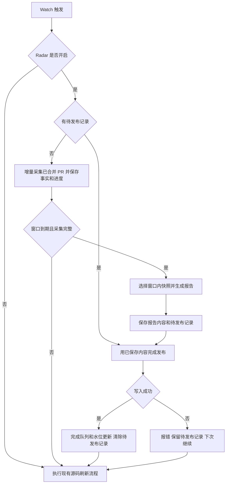

# GitHub PR Radar 技术设计

本文定义从最新 `main` 重新实现 Radar 的功能边界和验收口径。当前旧分支的代码仅用于核实已有接口、识别回归风险，不作为新实现的直接复制来源。

方案已对齐，基于最新 `main` 在 `feature/coding_radar_watch` 实现；单元测试自主执行，端到端测试前另外确认完整命令。

## 1. Radar 做什么

Radar 持续关注一个 GitHub 仓库已合并的 PR，把新合并的代码变化汇总成用户可阅读的报告。

它回答三个问题：

- 哪些 PR 已经合并，什么时候合并？
- 这些 PR 大致在解决什么问题，涉及哪些主题？
- 哪些变化值得用户关注？每条判断对应哪个真实 PR？

源码 Watch 负责刷新代码，Radar 负责整理已合并 PR。两者借用同一次 Watch 触发，但分别判断是否有工作需要执行。已确认：源码 HEAD 没有变化也要采集，Radar 在源码 HEAD 判重之前执行，不增加 HEAD 与 PR 采集之间的门控条件。

已确认：只收录 merged PR，未合并或关闭但未合并的 PR 不进入摘要和报告；已收录 PR 后续修改标题、标签等，不作为新的报告事件。

首版仅支持 GitHub 仓库，不增加其他代码托管平台、通知渠道、独立调度服务或跨仓库总报告。

## 2. 报告放在哪里

服务根据 Watch 所属用户和 Watch ID，生成唯一的输出根目录：

```text
viking://user/{user_id}/resources/radar/{watch_id}/
├── latest.md               最近一次成功发布的报告
├── reports/
│   └── {report_id}.md       历史报告
├── .radar-signals.jsonl     已采集、尚未完成发布的 PR 快照
└── .radar-state.json        采集进度、出报进度、待发布记录
```

这里的 `watch_id` 是对外返回的 Watch 标识，内部以现有 Watch 模型的字段为准，不能误用初次导入的任务 ID。账号隔离由现有存储上下文负责；URI 使用显式用户 ID。

地址由服务生成，不接受 `pr_radar.target_uri`，也不根据源码导入地址推导。传入自定义报告地址时，在创建入口直接报参数错误，不留到后台反复失败。

报告读写使用 Watch 所属账号、所属用户的普通 `USER` 上下文，`bypass_acl=False`。不复用源码后台导入的特权上下文。现有用户命名空间负责访问控制，Radar 不增加群组刷新、角色解析或共享目录 ACL。

用户仍然可以按现有接口读写自己的目录。Radar 不把整个用户目录设为专属或受保护目录，也不增加目录占用标记和通用文件操作拦截。`latest.md` 下次发布会被 Radar 更新；状态文件由 Radar 维护，手工修改后的恢复不属于本次保证范围。

同一仓库的两个 Watch 使用不同报告目录。源码资源移动不改变 Watch ID 时，报告地址保持不变，无须移动报告或执行反向回滚。暂停、恢复、删除 Watch 沿用现有行为；不增加历史报告自动删除或旧实现数据迁移。

## 3. 两个周期

| 参数 | 含义 | 本地验收取值 |
| --- | --- | --- |
| `watch_interval` | Watch 每隔多少分钟触发；Radar 随之采集 PR | `1`，即每分钟 |
| `pr_radar.digest_interval_minutes` | 持续运行阶段每份报告覆盖多少分钟 | `30` |
| `processing_mode` | 源码导入处理方式 | `vectors_only` |

每分钟采集，不等于每分钟调用模型或生成报告。不到出报时间，只保存新的 PR 快照。

开启 Radar 时必须显式提供 `digest_interval_minutes`，首版不设置未经确认的默认出报周期。Watch 保留原有默认周期，`1` 与 `30` 只属于本地验收配置。

`vectors_only` 是当前源码接受的实际值：跳过源码语义理解，仍执行向量处理。Radar 的模型摘要由 `summary_enabled` 单独控制，不能因源码使用此模式就禁用 Radar 摘要。

## 4. 一次 Watch 触发的核心流程



Radar 的调用位于源码 HEAD 判重、提前返回之前。Radar 调用结束后，源码 Watch 继续按原逻辑工作。

Radar 的失败需记录可核查原因，由后续触发重试；失败不改写源码 Watch 的业务结果。一次 Radar 调用使用有限的请求次数、超时和重试次数，避免无限等待。

### 4.1 采集事实

通过 `gh api` 增量读取已合并 PR，优先由 GitHub 查询条件限定 merged 和时间范围，避免拉取全部 PR 后才过滤。具体接口的筛选、排序、分页及结果上限在实现前核实，不能直接假定旧 issues 接口支持按合并时间筛选。

实现使用 `gh api graphql` 的 `search(type: ISSUE)`，查询包含 `repo:`、`is:pr`、`is:merged` 和 `merged:起点..终点`。每页最多 100 条，读取 PR 的真实 `mergedAt` 与其他事实字段。查询匹配超过 1,000 条时按秒拆分范围；单秒仍超限则报错、保留队列和未完成范围，不推进水位。每次执行最多 32 次请求，每次请求超时 30 秒；新收录上限由 `max_prs_per_run` 决定。跨触发只持久化未完成的时间范围，不持久化页内位置。

参考接口契约：

- https://docs.github.com/en/graphql/reference/search#query-search
- https://docs.github.com/en/search-github/searching-on-github/searching-issues-and-pull-requests#search-by-when-a-pull-request-was-merged

鉴权优先使用账号配置解析出的 GitHub token，或进程环境中的 `GH_TOKEN` / `GITHUB_TOKEN`；没有显式 token 时沿用 `gh` 已有登录，由 `gh` 解析凭证。显式 token 只传给子进程环境，不进入 Watch、队列或日志；保留 `GH_PROMPT_DISABLED=1`，禁用 CLI 交互提示。

当前旧实现已有水位：查询使用 `since=state.issues_since`；首次没有水位时才使用回溯起点。每轮从第 1 页读的是该时间范围内的结果，不是仓库全部历史。但旧水位按 `updated_at`，不能直接当作新设计的合并时间水位。

新设计保留两个独立进度：

- 采集水位：已完成并持久化的查询时间范围，首次从 7 天回溯起点开始，之后只查增量范围。
- 出报水位：已成功完成发布的报告窗口终点，发布失败时不推进。

查询边界保留必要重叠，并按仓库和 PR 编号判重；服务端索引延迟的重查范围及查询完整性以实际接口契约确定。不能把本轮最大的返回时间直接当作已完整扫描的进度。

`query_overlap_minutes` 默认回查 1,440 分钟，用于补查 GitHub 搜索索引延迟。GitHub 文档没有承诺索引延迟上界：这里的“采集完整”仅表示查询范围内当前可见的结果已分页读完，不表示可以证明 GitHub 尚未索引的 PR 不存在。若补查发现已发布窗口中有新出现的 PR，保留原始事实并报错等待检查，不将它归入其他时间窗口；超出重查范围的索引延迟没有完整性保证。

采集字段包括 PR 编号、标题、真实 URL、作者、状态、草稿标记、标签、描述，以及创建、更新、关闭、合并时间。不默认抓取评论、代码 diff 或开展源码影响分析。

分页和判重必须满足：

- 同一仓库的同一 merged PR 重复返回，不重复加入待出报队列。
- 同一秒合并的不同 PR 都要保留，不能只用时间判重。
- 已收录 PR 不因后续字段更新再次进入报告，不保留跨窗口的更新版本链。
- 本轮受请求上限、分页上限或网络失败影响时，保留已保存的事实，不把未读完的范围标为完成。
- 不使用跨触发保存的页内位置直接跳过前缀；重新读取时按 PR 身份判重。

采集进度表示已经安全处理的时间范围；分页只读取这个范围，不从仓库最早的 PR 开始。查询达到结果上限时，需要继续处理或拆分范围，不能把截断结果视为完整。

跨 Watch 的积累保留。例如一个窗口有 80 个 merged PR，每轮最多新收录 50 个：第一次保存 50 个原始 PR 和采集进度，不生成报告；第二次继续采集余下 30 个，与前次原始数据合并判重。窗口到期且查询完整后，用这 80 个 PR 生成一份报告。这里保存的是报告素材，生成报告后的发布记录由独立环节维护。

### 4.2 等待并选择报告窗口

以 Watch 创建时间 `T0` 为锚点，转换为 UTC 并按秒对齐：

- 初次回溯覆盖 `[T0 - backfill_days, T0]`，回溯采集完整后即可发布，不额外等待 30 分钟。
- 后续窗口依次覆盖 `(T0, T0 + 30分钟]`、`(T0 + 30分钟, T0 + 60分钟]`。
- 边界采用前开后闭，避免同一个边界快照被连续两份报告重复计入。首次窗口包含回溯起点。
- 以 GitHub `merged_at` 归属窗口，每个 PR 的合并事件只归属一个窗口。
- 同一 PR 不做多版本追踪，报告使用采集到的事实。
- 到期但采集未完成时，推迟出报，不声称已覆盖完整窗口。
- 窗口内没有 PR 时，只推进出报进度，不调用模型、不生成空报告，`latest.md` 保留上次成功报告。
- 停机后积累多个到期窗口，后续触发按窗口顺序补齐，不合并成一份标注错误的大报告。

首版不做队列达到阈值后提前发布的“部分报告”，也不做续篇拼接。每轮采集量和模型输入量保留有限上限；达到采集上限就下轮继续，模型输入按批次处理。

报告定位为“已合并 PR 的代码变化摘要”，不追踪合并前的中间事件。标题、描述等是采集时的内容，不声称还原合并瞬间的历史文本。

### 4.3 生成可追溯的报告

先形成确定性的 PR 事实列表，再按开关增加模型摘要：

1. 逐 PR 分批整理中文摘要、主题、关注级别、影响和建议。
2. 在这些结果上整理主题概览与重点 PR。
3. 把模型输出与原始事实组合为 Markdown 报告。

编号、标题、链接、作者、状态和时间始终来自采集结果。模型只负责解释，不得生成或修改这些事实。模型返回的编号必须在本批输入中，主题重点必须属于相应主题。

模型失败时分级降级：主题归组失败保留逐 PR 摘要；部分批次失败，其余 PR 仍保留事实；模型完全失败或摘要关闭时发布模板报告。报告标明实际生成模式，模型解释不能冒充已验证的源码结论。

复用已有账号 `vlm_resolver`，不创建另一套模型配置。每份报告最多调用模型 16 次，每次超时 30 秒；超过调用预算的内容保留事实并降级。逐 PR 与主题概览的 JSON 输入分别按 `summary_batch_bytes` 分批，单条超长描述截短。模式为 `llm`、`pr_summaries`、`partial` 或 `template`，按实际成功范围标记。

报告至少包含仓库、窗口、生成时间、PR 数量、事实列表和真实 PR 链接；开启且成功生成摘要时，增加中文解读和主题概览。

### 4.4 发布与失败恢复

发布涉及历史文件、`latest.md`、队列和进度，不能假设这些文件能一次同时写成功。

已确认保留待发布记录，保存逻辑限定在 Radar 内部，复用 Radar 的状态读写函数和现有 VikingFS，不改造公共存储接口。执行顺序：

1. 生成报告，保存固定报告 ID、完整内容、窗口信息，以及发布完成后的队列和状态。
2. 待发布记录成功落盘后，写历史报告和 `latest.md`。
3. 更新队列及出报水位；所有更新完成后清除待发布记录。

待发布记录保存前失败，原始 PR 和旧出报水位仍保留，下次可以重新生成。记录保存后任一步失败，记录错误并结束本轮；下次触发先读取该记录，用同一报告 ID 和内容重新完成发布，不重复调用模型。队列即使已经改写，也能根据记录恢复到预定结果，不丢失窗口数据。

重复写入同一历史文件、`latest.md` 和预定状态必须得到相同结果。发布未完成时不采集新数据，避免恢复记录覆盖后来采集的 PR；恢复完成后由后续正常触发继续增量采集。多文件写入失败期间可能暂时不一致，成功恢复后收敛。

原始 PR 队列用于跨 Watch 采集合并，待发布记录用于报告落盘失败续写，两者均保留。部分报告及其续篇记录 `partial_fragments` 取消。

采集事实和采集进度同样遵循“先保存事实，再推进进度”；重启后的重读由判重消化。读取状态失败不能被当作全新 Watch 静默覆盖。

同一个 Watch 的执行互斥沿用现有 Watch 调度保证。新实现先核实最新 `main` 的契约，仅为确有需要的 Radar 状态操作补最小保障，不引入源码资源移动锁或公共账号锁。

## 5. 配置范围

HTTP 导入时配置放在现有 `args` 中；下面是参数结构，不是已经执行过的验收请求：

```json
{
  "processing_mode": "vectors_only",
  "watch_interval": 1,
  "args": {
    "pr_radar": {
      "enabled": true,
      "backfill_days": 7,
      "digest_interval_minutes": 30,
      "max_prs_per_run": 50,
      "summary_enabled": true,
      "summary_batch_bytes": 60000
    }
  }
}
```

`args.pr_radar` 经现有资源导入参数合并，服务保存在 Watch 的 `processor_kwargs` 中。调度执行读取此配置后移除交给源码解析器的 `pr_radar` 参数，Watch 内保存的配置不变。

首次配置校验在导入/创建 Watch 入口完成：仓库平台、参数类型、取值范围，以及已移除的自定义报告地址。不为 Radar 改造公共鉴权缓存、群组索引、账号锁、共享资源 ACL、文件移动回滚或 Watch 存储表结构。

## 6. 最小模块划分

| 模块 | 职责 |
| --- | --- |
| 配置与数据模型 | 校验开关、周期、上限；定义已合并 PR 和状态 |
| GitHub 采集器 | 增量查询、分页、采集水位、PR 编号判重 |
| Radar 状态存储 | 保存已合并 PR、采集水位、出报水位和待发布记录 |
| 摘要与渲染 | 模型分诊、主题归组、校验和模板降级 |
| Radar Runner | 串联采集、窗口判断、生成和发布 |
| 现有 Watch 接线 | 创建时校验；每次触发调用 Runner |

不设置独立的报告目录所有权模块。上线前根据最新 `main` 的真实接口确定文件位置，避免为沿用旧实现而制造公共依赖。

## 7. 本地验收

测试开始前，先给用户确认实际配置路径、服务启动命令、导入请求、鉴权来源、读报告命令，以及已有数据的使用方式。命令确认后再启动服务和写入数据。

固定测试条件：

- 本地端口 `1935`，使用 Radar 测试配置。
- 导入 `https://github.com/volcengine/OpenViking` 源码。
- `processing_mode=vectors_only`。
- `watch_interval=1` 分钟。
- `digest_interval_minutes=30`，开启 Radar 模型摘要。
- 从创建返回值获取真实 Watch ID，以所属用户和 Watch ID 确定报告地址。

验收证据：

| 检查项 | 合格证据 |
| --- | --- |
| 源码导入 | 真实导入任务完成，资源可读取 |
| 初次回溯 | 查询完成后生成报告；窗口和采集 PR 一致 |
| HEAD 不变 | 后续 Watch 触发仍执行 Radar 采集 |
| 30 分钟窗口 | 未到期只积累；到期且采集完整后正确发布或关闭空窗口 |
| 报告事实 | 抽查编号、URL、状态、时间与真实 GitHub 返回相符 |
| 模型摘要 | 明确是否实际成功；重点 PR 没有串到别的主题 |
| 发布失败 | 原始数据或待发布记录可用；下次完成同一窗口，已保存报告不重复调用模型 |
| 用户路径 | 实际输出位于所属用户的固定 Watch 目录 |

增量查询、同秒多个合并、PR 编号判重、合并时间窗口、模型降级和发布中断由受控本地回归覆盖；真实链路测试报告只声明实际验证过的行为。

必须提供真实的 `latest.md` URI、至少一份实际历史报告 URI、窗口、PR 数量和生成模式。不能把示例 URI 当成真实地址，也不能仅凭 Watch 调度成功就认定报告生成成功。若真实窗口没有更新，明确报告空窗口事实，不制造变化。

## 8. 已确认的口径

1. 报告固定按用户和 Watch ID 存放，用户目录沿用现有读写规则，取消自定义地址和目录保护机制。
2. 初次先生成 7 天回溯报告，后续每 30 分钟出报；无更新的窗口不生成新文件。
3. 已确认 HEAD 不变也采集、只关注 merged PR；增量查询不拉取全部历史。
4. 已确认保留原始 PR 队列和待发布记录，支持跨 Watch 积累及发布失败恢复；取消部分报告和续篇。

初版新增 46 个单元测试全部通过；扩展单测共 84 通过、1 失败。失败用例为 `test_leader_loop_dispatches_due_watches`，原因是当时本地原生绑定缺少 `leader_validate_async`；原 `main` HEAD 使用同一绑定也复现相同失败。用户随后重新编译原生绑定并启动服务。恢复 `gh` 已有登录后，采集器单测 9 个通过，Radar 单测共 49 个通过。

2026-11-14 本地 Radar 验收结果：

- Watch：`47e2b05c-19f5-441b-b08b-7e91d47f0405`，服务端口 `1935`，使用 `~/.openviking/ov_radar.config`；采集周期 1 分钟、出报周期 30 分钟、首次回溯 1 天。
- 实际目录：`viking://user/default/resources/radar/47e2b05c-19f5-441b-b08b-7e91d47f0405/`。
- 历史报告：`reports/053a4cf4-a354-4f16-b26d-05caa6030c58.md`，与该目录下 `latest.md` 内容一致。
- 首份窗口：北京时间 `2026-11-13 01:58:10` 至 `2026-11-14 01:58:10`；报告中 48 个 PR 编号唯一，全部为 merged，合并时间均在窗口内，链接指向对应仓库和编号。
- 模型模式 `pr_summaries`：48 条逐 PR 摘要、12 个主题概览；已生成概览中的重点 PR 均属于相应主题。没有把部分主题概览声称为完整模型模式。
- 状态 `backfill_done=true`、`last_error=null`、无待发布记录、原始队列为空；出报水位已到北京时间 `2026-11-14 02:28:10`，首个后续 30 分钟空窗口已关闭，`latest.md` 保留回溯报告。
- 上述结果验证 Radar 的真实采集、模型摘要和落盘链路；没有据此宣称源码导入任务终态、所有后续窗口或真实发布故障注入已验证。
