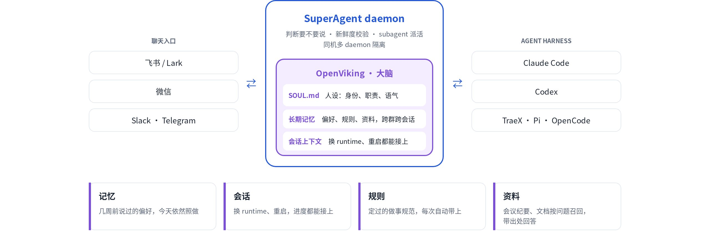
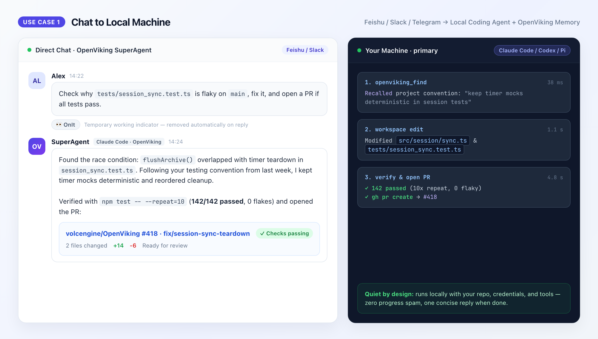
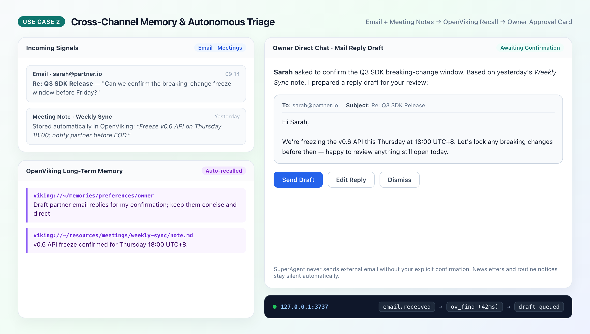

# OpenViking SuperAgent

**Bring Your Own Machine. Run your own agent.**

Set up your machine (local or a cloud VM) with the software, projects, and tools you need. OpenViking SuperAgent connects your coding agent to [OpenViking](../README.md) and instant messaging: send a task in chat, let your agent work on your machine, and receive the results in the same conversation. OpenViking provides long-term memory, knowledge, and session continuity across restarts and runtime switches.

Supports runtimes including **Claude Code**, **Codex**, **DeepSeek Harness**, and **Pi / Durable**, and connects to **Feishu / Lark**, **WeChat**, **Telegram**, **Slack**, **QQ** (official bot or personal account via OneBot), **DingTalk groups**, and **email**. The CLI command is `ov-superagent`.

[Architecture](#architecture) · [See It in Action](#see-it-in-action) · [Quick Start](#quick-start) · [Everyday Use](#everyday-use) · [Documentation](#documentation) · [Configuration Example](config.example.json) · [Contributing](../CONTRIBUTING.md)

---

## Architecture

<p align="center">
  
</p>

OpenViking SuperAgent sits between your messaging channels and your local coding agent harness:

- **Chat & Event Entry**: Connects Feishu / Lark, WeChat, Slack, Telegram, QQ, DingTalk, and email into one unified daemon.
- **SuperAgent Daemon + OpenViking Brain**: Decides when to reply vs. stay silent, enforces freshness checks, dispatches subagents, and isolates multiple daemons on the same host. Backed by OpenViking (`SOUL.md` persona, long-term preferences/rules/resources, and continuous session context across restarts or runtime switches).
- **Agent Harness**: Drives your chosen local runtime (Claude Code, Codex, TraeX, Pi, OpenCode, or DeepSeek Harness) directly inside your configured workspace.

---

## See It in Action

### 1. Chat to Local Machine

Send a task from Feishu, Slack, or Telegram. SuperAgent recalls project conventions from OpenViking, runs your local coding agent in your workspace, verifies tests, and replies once with the result.

<p align="center">
  
</p>

### 2. Cross-Channel Memory & Autonomous Triage

Incoming emails and Feishu meeting notes are indexed in OpenViking. When something needs your attention, SuperAgent connects the dots across channels and sends a concise summary or interactive approval card to your direct chat—never sending external mail without confirmation.

<p align="center">
  
</p>

---

## Why OpenViking SuperAgent

| Capability | What It Gives You |
|---|---|
| **Bring Your Own Machine** | Your agent runs directly against your local software, repos, and credentials, bridged to OpenViking and IM. |
| **Use Your Preferred Runtime** | Connect an authenticated local coding agent (Claude Code, Codex, DeepSeek Harness) or use the bundled Pi / Durable runtime. See [runtime setup](docs/installation-reference.md#prerequisites). |
| **Persistent Context Across Sessions** | OpenViking archives session history for fresh sessions and runtime switches, and provides long-term memory and resource search. See [session context](docs/ov-session-context.md). |
| **Multi-Channel & Multi-Instance** | One instance can serve multiple chat channels; separate instances keep isolated workspaces, data directories, and OpenViking configurations. See [multiple instances](docs/installation-reference.md#multiple-agents). |

---

## Quick Start

You need a configured model runtime and **an OpenViking service (required; local or remote)**. Choose the command for your system; both installers open the same interactive `ov-superagent setup` on first installation.

**macOS / Linux / WSL2 (x64 or arm64):**

```bash
curl -fsSL https://ovrelease.tos-cn-beijing.volces.com/superagent/install.sh | sh
```

To pin a specific release:

```bash
curl -fsSL https://ovrelease.tos-cn-beijing.volces.com/superagent/releases/<version>/install.sh | sh -s -- --version <version>
```

**Windows 10/11 (x64, preview), in PowerShell 5.1 or 7:**

```powershell
irm https://ovrelease.tos-cn-beijing.volces.com/superagent/install.ps1 | iex
```

The package bundles Node, PM2, chat CLIs, Pi, and Durable. On first installation, `ov-superagent setup` connects OpenViking, selects a runtime and workspace, and authorizes your chat channels. You do not need to install `lark-cli` globally.

- For **Codex** or **Claude Code**, install and sign in to that CLI first.
- For **DeepSeek Harness**, install `dsh` **0.2.x** (`0.2.2-rc.1` or later) on Node 24.9+, then manage its model routes with `ov-superagent dsh model`.

Once configured, send the bot a task in a direct chat:

> Inspect the project in your workspace, explain how to start it, and check whether its tests pass.

See the [installation guide](install.md) for details. For native Termux arm64, see [Termux installation](docs/termux.md); it uses the same POSIX installer with native Node and `lark-cli`.

---

## Everyday Use

### In Chat

Send these slash commands in a direct chat with your agent:

- `/help` — list available commands
- `/status` — inspect runtime, model, and session status
- `/model` and `/effort` — inspect or switch model settings
- `/new` — start a new session

### In Your Terminal

```bash
ov-superagent setup           # Add or edit an instance
ov-superagent status          # Check running instances
ov-superagent logs primary    # Tail logs for the primary instance
```

For upgrades and rollbacks, see the [platform-specific instructions](docs/installation-reference.md#upgrade-and-rollback).

### Local Console

Open `http://127.0.0.1:3737` to monitor live message processing, tool calls, and delivery activity.

> [!IMPORTANT]
> **Connect trusted chats only.** The agent can operate on its configured workspace, and chats served by one instance share runtime context. Feishu setup asks whether to authorize searching and reading messages as your user; review the scope before granting access. See [message access](docs/usage-reference.md#message-access).

---

## Documentation

The release-process guide is currently in Chinese.

| Topic | Guide |
|---|---|
| Installation, model sign-in, first connection | [Installation](install.md) |
| Chat channels, email, attachments, and cards | [Feature reference](docs/usage-reference.md#chat-channels-and-email) |
| QQ groups through a personal account (OneBot) | [OneBot Connector](docs/onebot-connector.md) |
| DingTalk internal group mentions, replies and reminders | [DingTalk setup](docs/installation-reference.md#dingtalk-group-setup) |
| An IM you connect yourself | [External Connector](docs/external-connector.md) |
| Permissions, sign-in, upgrades, rollback, and development | [Configuration and operations](docs/installation-reference.md) |
| Context archival and recovery | [OV session context](docs/ov-session-context.md) |
| Adding message sources | [Connector protocol](docs/connector-protocol.md) |
| Durable models and recovery | [Durable runtime](docs/pi-durable-runtime.md) |
| DSH model routes, credentials, and limits | [DSH runtime](docs/dsh-runtime.md) |
| Reliability and acceptance checks | [Reliability limits](docs/usage-reference.md#reliability-limits) · [Feishu acceptance](docs/usage-reference.md#feishu-acceptance-checks) |

---

Features in the source tree may not yet be published. Check your installed release.

Pre-release installations (`~/.vika`, `~/.ovsa`, `~/.superagent`) are not migrated. The installer stops their processes and autostart entries and then performs a fresh install into `~/.ov-superagent`; the old directory is left in place for you to inspect or delete.
